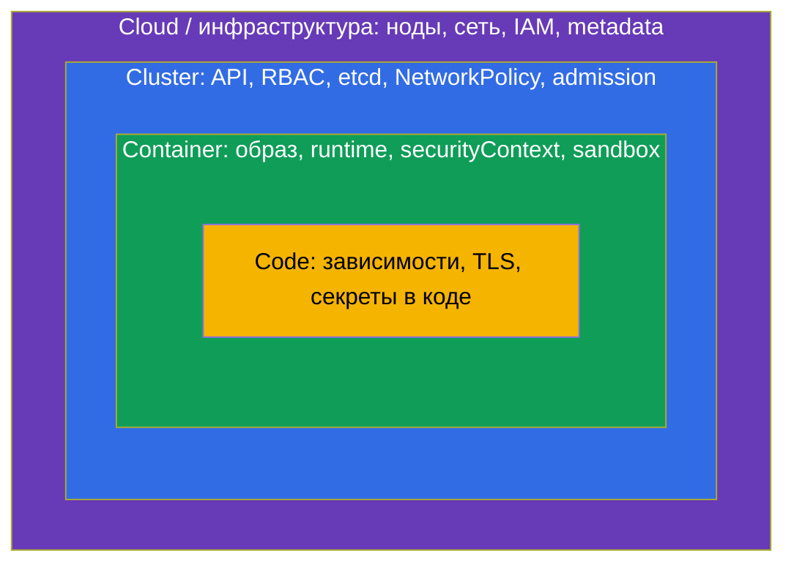
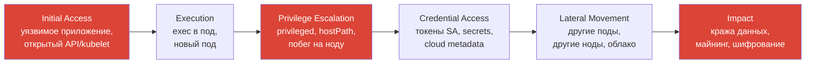

# Глава 1. Модель угроз Kubernetes и карта экзамена CKS

> **С чего начинаем.** CKA научил вас строить и чинить кластер. CKS учит смотреть на тот же
> кластер глазами атакующего: где вход, куда можно пойти дальше, что можно украсть и как это
> заметить. В этой главе разберём общую модель угроз, принцип defense-in-depth и то, как
> шесть доменов экзамена складываются в единую картину. Остальные главы курса - это
> детальный разбор каждого слоя.

## 1.1. Почему безопасность Kubernetes - отдельная дисциплина

Kubernetes по умолчанию оптимизирован под удобство, а не под безопасность:

- сеть плоская - любой под может обратиться к любому другому поду в кластере;
- каждый под получает токен ServiceAccount, примонтированный в файловую систему;
- контейнеры по умолчанию запускаются от root (если образ не говорит иного);
- Secret хранятся в etcd в base64, то есть фактически открытым текстом;
- никакого аудита запросов к API не ведётся, пока вы его не включите;
- в кластер можно запустить образ из любого реестра.

Каждый пункт - это не баг, а дефолт, который вы как администратор должны осознанно
поменять. CKS проверяет именно это: знаете ли вы, какие дефолты опасны, и умеете ли быстро
их исправить руками в живом кластере.

## 1.2. 4C: слои облачной безопасности

Документация Kubernetes описывает безопасность через модель **4C**: Cloud, Cluster,
Container, Code. Каждый внешний слой - фундамент для внутреннего: идеальный код не спасёт,
если в облаке открыт etcd в интернет.



| Слой | Типичные угрозы | Где в курсе |
|------|-----------------|-------------|
| Cloud | кража IAM-кредов через metadata, открытые порты нод | главы 5, 11 |
| Cluster | анонимный доступ к API, широкий RBAC, секреты в etcd | главы 3, 7-10, 14 |
| Container | root, privileged, побег из контейнера, уязвимый образ | главы 12, 13, 15, 17 |
| Code | уязвимые зависимости, утечка секретов | главы 18-20 |

## 1.3. Как выглядит атака на кластер

Полезно держать в голове типовую цепочку атаки. Microsoft опубликовала **Threat Matrix for
Kubernetes**, а MITRE - матрицу **ATT&CK for Containers**. Упрощённо фазы такие:



Каждый домен CKS разрывает эту цепочку в своём месте:

- **Initial Access** - закрываем доступ к API и kubelet (главы 5, 9), TLS на Ingress
  (глава 4), сканируем образы и манифесты (главы 18-20).
- **Execution / Privilege Escalation** - Pod Security Standards, securityContext, AppArmor,
  seccomp, gVisor (главы 12, 13, 15).
- **Credential Access** - RBAC и ServiceAccount (главы 7, 8), шифрование секретов (глава 14),
  защита metadata (глава 5).
- **Lateral Movement** - NetworkPolicy и шифрование pod-to-pod (главы 2, 16).
- **Обнаружение на всех фазах** - аудит, Falco, расследование (главы 21-24).

## 1.4. Defense-in-depth и least privilege

Два принципа, которые пронизывают весь курс:

**Defense-in-depth (эшелонированная защита).** Ни один механизм не считается достаточным.
NetworkPolicy может быть неверно написана, образ может содержать 0-day, RBAC может быть
широковат. Поэтому ставим несколько независимых барьеров: если атакующий прошёл один, его
остановит (или хотя бы обнаружит) следующий.

**Least privilege (минимальные привилегии).** Каждый субъект - пользователь, ServiceAccount,
процесс в контейнере, нода, облачная роль - получает ровно те права, что нужны для его
задачи, и не больше. На экзамене это формулируется как «minimize», «restrict», «reduce
exposure» - почти в каждом домене.

## 1.5. Домены экзамена и структура курса

Актуальная программа CKS (экзамен на Kubernetes v1.35):

| Домен | Вес | Главы курса |
|-------|-----|-------------|
| Cluster Setup | 15% | 2, 3, 4, 5, 6 |
| Cluster Hardening | 15% | 7, 8, 9, 10 |
| System Hardening | 10% | 11, 12 |
| Minimize Microservice Vulnerabilities | 20% | 13, 14, 15, 16 |
| Supply Chain Security | 20% | 17, 18, 19, 20 |
| Monitoring, Logging and Runtime Security | 20% | 21, 22, 23, 24 |

Обратите внимание: 60% веса - это три «тяжёлых» домена по 20%. Supply Chain и Runtime
Security требуют сторонних инструментов (Trivy, Falco, kubesec, cosign), которых не было в
CKA, - на них стоит выделить больше времени.

## 1.6. Инструментарий CKS

В отличие от CKA, на CKS помимо `kubectl` и `kubeadm` нужно уверенно работать с целым
набором утилит. Минимальный список:

| Инструмент | Для чего | Глава |
|------------|----------|-------|
| `kube-bench` | проверка CIS Benchmark | 3 |
| `openssl`, `sha512sum` | сертификаты, проверка бинарников | 4, 6, 7 |
| `etcdctl` | чтение/проверка данных etcd | 14 |
| `apparmor_parser`, `aa-status` | профили AppArmor | 12 |
| `crictl` | работа с контейнерами на ноде | 15, 23 |
| `trivy` | сканирование образов, SBOM, конфигов | 18, 20 |
| `kubesec`, `kube-linter` | статический анализ манифестов | 20 |
| `cosign` | подпись и проверка образов | 19 |
| `falco` | runtime-детект | 22 |
| `ss`, `lsof`, `systemctl`, `journalctl` | харденинг и расследование на ноде | 11, 23 |

## 1.7. Где «живут» настройки компонентов

Большая часть задач CKS - это правка конфигурации компонентов на control plane и нодах.
Держите эту карту в голове:

| Компонент | Где конфигурируется | Как применить |
|-----------|---------------------|---------------|
| kube-apiserver | `/etc/kubernetes/manifests/kube-apiserver.yaml` | kubelet сам перезапустит static pod |
| etcd | `/etc/kubernetes/manifests/etcd.yaml` | так же |
| controller-manager, scheduler | `/etc/kubernetes/manifests/*.yaml` | так же |
| kubelet | `/var/lib/kubelet/config.yaml` (+ `/etc/systemd/system/kubelet.service.d/`) | `systemctl daemon-reload && systemctl restart kubelet` |
| containerd | `/etc/containerd/config.toml` | `systemctl restart containerd` |

Золотое правило: **перед правкой static pod манифеста сделайте копию** (не в ту же
директорию - иначе kubelet попытается запустить и копию):

```bash
cp /etc/kubernetes/manifests/kube-apiserver.yaml /root/kube-apiserver.yaml.bak
```

Если после правки API не поднимается - смотрите логи:

```bash
crictl ps -a | grep kube-apiserver
crictl logs <container-id>
tail -f /var/log/pods/kube-system_kube-apiserver-*/kube-apiserver/*.log
journalctl -u kubelet -f | grep -i apiserver
```

## 1.8. Итоги главы

- Kubernetes по умолчанию небезопасен: плоская сеть, токены в каждом поде, root в
  контейнерах, секреты в base64, нет аудита.
- Модель 4C: Cloud → Cluster → Container → Code; внешний слой - фундамент внутреннего.
- Типовая атака: initial access → execution → privilege escalation → credential access →
  lateral movement → impact. Каждый домен CKS разрывает цепочку в своём месте.
- Главные принципы - defense-in-depth и least privilege.
- 60% экзамена - Microservice, Supply Chain и Runtime Security.
- Конфигурация control plane - в static pod манифестах, kubelet - в `config.yaml`. Бэкап
  перед правкой - обязателен.

## 1.9. Вопросы для самопроверки

1. Назовите пять небезопасных дефолтов Kubernetes.
2. Что означает каждая «C» в модели 4C и почему порядок слоёв важен?
3. На какой фазе атаки помогает NetworkPolicy, а на какой - шифрование секретов в etcd?
4. Почему бэкап static pod манифеста нельзя класть в `/etc/kubernetes/manifests/`?
5. Как найти причину, если после правки манифеста kube-apiserver не стартует?

## Практика

Поднимите любую лабу CKS и осмотрите кластер «глазами атакующего»: какие поды запущены от
root, у каких подов примонтирован токен SA, есть ли в namespace хоть одна NetworkPolicy.
Начните с лабы про контексты и сертификаты пользователей:

🧪 Лаба 01: [tasks/cks/labs/01](../../labs/01/README.MD)

```bash
TASK=01 make run_cks_task      # развернуть
TASK=01 make delete_cks_task   # удалить
```

---
[Оглавление](../README_RU.md) · [Глава 2](../02/ru.md)
