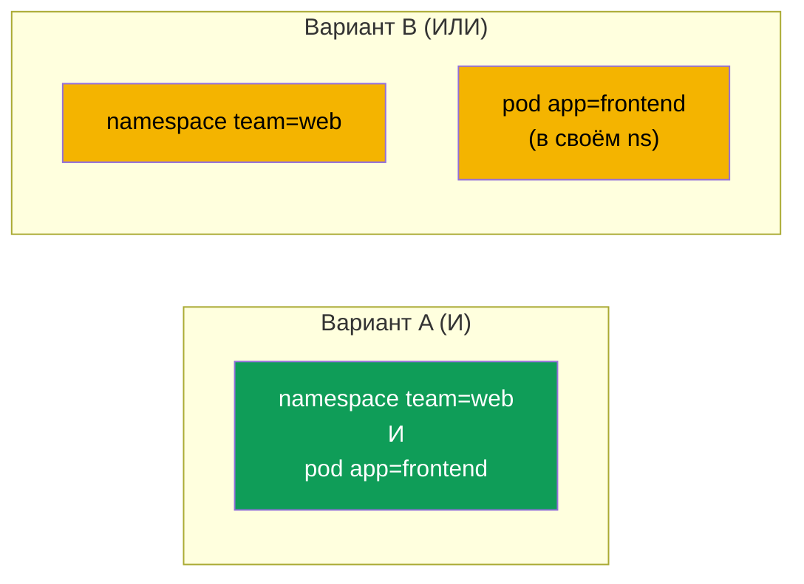
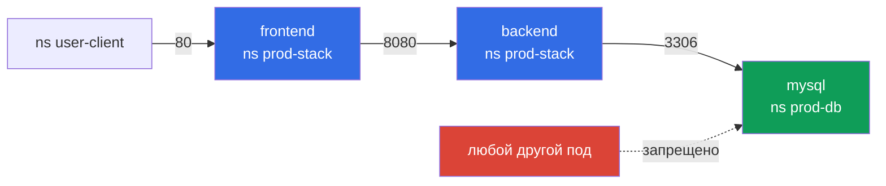

# Глава 2. NetworkPolicy: ограничиваем доступ на уровне кластера

> **Что дальше.** Открываем домен **Cluster Setup (15%)**. Первый барьер против lateral
> movement - сетевая изоляция. По умолчанию в Kubernetes любой под может говорить с любым,
> и атакующий, захвативший один фронтенд, спокойно доходит до базы данных. В этой главе
> научимся строить модель «default deny + явные разрешения» стандартными NetworkPolicy и
> посмотрим, что добавляют политики Cilium.

## 2.1. Модель по умолчанию и как её меняет NetworkPolicy

Пока в namespace нет ни одной NetworkPolicy, выбирающей под, этот под **не изолирован**:
принимает трафик отовсюду и ходит куда угодно. Как только хотя бы одна политика выбрала под
(через `podSelector`) по направлению `Ingress` или `Egress`, этот под становится
**изолированным** по этому направлению: разрешено только то, что явно разрешает
объединение (union) всех политик, выбравших под.

Ключевые свойства:

- политики **только разрешающие** - запрещающих правил в стандартной NetworkPolicy нет;
- политики **аддитивны** - разрешения из разных политик складываются, порядок не важен;
- NetworkPolicy - это namespaced-объект и выбирает поды **только своего** namespace;
- исполняет их **CNI-плагин** (Calico, Cilium и т.д.). Если CNI не поддерживает политики
  (например, flannel), объекты создадутся, но ничего не будут делать.

Для ответного трафика правила писать не нужно: соединения stateful, ответ на разрешённый
запрос пропускается автоматически.

## 2.2. Default deny

Первое, что делаем в защищаемом namespace, - запрещаем всё:

```yaml
apiVersion: networking.k8s.io/v1
kind: NetworkPolicy
metadata:
  name: default-deny
  namespace: prod
spec:
  podSelector: {}          # все поды namespace
  policyTypes:
  - Ingress
  - Egress                 # правил нет - значит, ничего не разрешено
```

Сразу после этого поды перестанут резолвить имена: DNS - это тоже egress. Поэтому почти
всегда рядом нужна политика, разрешающая DNS:

```yaml
apiVersion: networking.k8s.io/v1
kind: NetworkPolicy
metadata:
  name: allow-dns
  namespace: prod
spec:
  podSelector: {}
  policyTypes:
  - Egress
  egress:
  - to:
    - namespaceSelector:
        matchLabels:
          kubernetes.io/metadata.name: kube-system
      podSelector:
        matchLabels:
          k8s-app: kube-dns
    ports:
    - protocol: UDP
      port: 53
    - protocol: TCP
      port: 53
```

Метка `kubernetes.io/metadata.name` автоматически ставится на каждый namespace - это самый
надёжный способ выбрать namespace по имени.

## 2.3. Селекторы: самая частая ошибка на экзамене

Внутри `from` / `to` можно указать `podSelector`, `namespaceSelector` и `ipBlock`. Разница
между «И» и «ИЛИ» определяется **одним дефисом** YAML:

```yaml
# ВАРИАНТ A: один элемент списка = условие «И»
# поды с app=frontend, находящиеся в namespace с team=web
ingress:
- from:
  - namespaceSelector:
      matchLabels:
        team: web
    podSelector:
      matchLabels:
        app: frontend
```

```yaml
# ВАРИАНТ B: два элемента списка = условие «ИЛИ»
# ЛЮБОЙ под из namespace team=web ИЛИ поды app=frontend из СВОЕГО namespace
ingress:
- from:
  - namespaceSelector:
      matchLabels:
        team: web
  - podSelector:
      matchLabels:
        app: frontend
```



Вариант B открывает гораздо больше, чем кажется. Перечитывайте отступы дважды.

Ещё нюансы:

- `podSelector` без `namespaceSelector` внутри `from` выбирает поды **только из namespace
  политики**;
- `namespaceSelector: {}` - все namespace кластера;
- `ipBlock` применяется к IP **за пределами** кластера; для IP подов поведение зависит от
  CNI, не полагайтесь на него для pod-to-pod.

## 2.4. Типовая схема трёхзвенного приложения

Разрешаем цепочку `user-client → frontend → backend → mysql`, всё остальное запрещено:



Политика на стороне mysql (ingress только от backend из другого namespace):

```yaml
apiVersion: networking.k8s.io/v1
kind: NetworkPolicy
metadata:
  name: mysql-from-backend
  namespace: prod-db
spec:
  podSelector:
    matchLabels:
      app: mysql
  policyTypes:
  - Ingress
  ingress:
  - from:
    - namespaceSelector:
        matchLabels:
          kubernetes.io/metadata.name: prod-stack
      podSelector:
        matchLabels:
          app: backend
    ports:
    - protocol: TCP
      port: 3306
```

Помните: если в `prod-stack` действует default deny на **egress**, backend тоже нужна
egress-политика «к mysql в prod-db на 3306». Трафик должен быть разрешён **с обеих сторон**.

## 2.5. Защита metadata и чувствительных адресов через egress

Частая задача: запретить подам доступ к облачному metadata-эндпоинту `169.254.169.254`,
оставив остальной интернет:

```yaml
apiVersion: networking.k8s.io/v1
kind: NetworkPolicy
metadata:
  name: deny-metadata
  namespace: prod
spec:
  podSelector: {}
  policyTypes:
  - Egress
  egress:
  - to:
    - ipBlock:
        cidr: 0.0.0.0/0
        except:
        - 169.254.169.254/32
```

Подробнее о metadata - в главе 5.

## 2.6. Проверка политик

```bash
kubectl get netpol -A
kubectl describe netpol mysql-from-backend -n prod-db

# проверка доступности из конкретного пода
kubectl -n prod-stack exec deploy/backend -- nc -zv -w 2 mysql.prod-db 3306
kubectl -n prod-stack exec deploy/frontend -- nc -zv -w 2 mysql.prod-db 3306   # должно упасть

# временный под-клиент
kubectl run tmp --rm -it --image=busybox -n user-client -- wget -qO- -T 2 frontend.prod-stack
```

`kubectl describe netpol` очень удобно расшифровывает, кого именно выбирает политика, - это
лучший способ поймать ошибку «И/ИЛИ».

## 2.7. Политики Cilium: L7, FQDN и явный deny

Стандартная NetworkPolicy работает на L3/L4. Если в кластере Cilium, доступны
`CiliumNetworkPolicy` (namespaced) и `CiliumClusterwideNetworkPolicy`:

- **L7-правила** - например, разрешить только `GET /api/.*`;
- **FQDN-правила** - egress по доменному имени (`toFQDNs`), а не по IP;
- **entities** - `world`, `cluster`, `host`, `kube-apiserver`;
- **явный deny** - `ingressDeny` / `egressDeny`, которые имеют приоритет над allow.

```yaml
apiVersion: cilium.io/v2
kind: CiliumNetworkPolicy
metadata:
  name: backend-l7
  namespace: prod-stack
spec:
  endpointSelector:
    matchLabels:
      app: backend
  ingress:
  - fromEndpoints:
    - matchLabels:
        app: frontend
    toPorts:
    - ports:
      - port: "8080"
        protocol: TCP
      rules:
        http:
        - method: GET
          path: "/api/.*"
```

Cilium также умеет требовать взаимную аутентификацию между подами (`authentication.mode:
required`) - это тема главы 16.

## 2.8. Best practices

- **Default deny в каждом прикладном namespace** (ingress и egress), затем явные
  разрешения. Не забывайте про DNS.
- **Выбирайте namespace по `kubernetes.io/metadata.name`**, а не по самодельным меткам,
  которые кто-то может поменять.
- **Разрешайте трафик с обеих сторон** при default deny на egress.
- **Проверяйте, что CNI исполняет политики.** Политика без поддержки CNI - иллюзия защиты.
- **Закройте egress к metadata** и к API-серверу для подов, которым он не нужен.
- **Сеть - не авторизация.** NetworkPolicy оперирует IP и метками; для identity-based
  доступа нужен mTLS + авторизация (глава 16).

## 2.9. Итоги главы

- Без политик под не изолирован; первая политика, выбравшая под, изолирует его по своему
  направлению.
- Политики только разрешающие и аддитивные; исполняет их CNI.
- Default deny = `podSelector: {}` + `policyTypes` без правил. DNS разрешаем отдельно.
- Один элемент списка с `namespaceSelector` и `podSelector` = «И»; два элемента = «ИЛИ».
- Egress-исключение `169.254.169.254/32` закрывает доступ к облачным метаданным.
- Cilium добавляет L7, FQDN, entities и явные deny-правила.

## 2.10. Вопросы для самопроверки

1. Что происходит с подом, когда его выбирает первая NetworkPolicy с `policyTypes: [Egress]`?
2. Почему после default deny egress ломается резолвинг имён и как это исправить?
3. Чем отличаются два варианта `from` из раздела 2.3? Нарисуйте, кого пускает каждый.
4. Как выбрать namespace по имени, не добавляя собственных меток?
5. Какие возможности даёт CiliumNetworkPolicy сверх стандартной NetworkPolicy?

## Практика

Постройте default deny и цепочку разрешений для трёхзвенного приложения:

🧪 Лаба 22: [tasks/cks/labs/22](../../labs/22/README.MD)

Политики Cilium (L3/L4/L7 и mutual authentication):

🧪 Лаба 27: [tasks/cks/labs/27](../../labs/27/README.MD)

---
[Оглавление](../README_RU.md) · [Глава 1](../01/ru.md) · [Глава 3](../03/ru.md)
