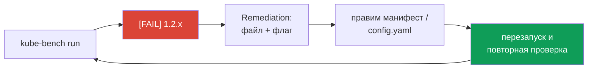

# Глава 3. CIS Benchmark и безопасная конфигурация компонентов

> **Что дальше.** Как понять, что control plane и ноды настроены безопасно? Не «на глаз», а
> по проверяемому стандарту. Таким стандартом является **CIS Kubernetes Benchmark**, а
> инструментом проверки - **kube-bench**. В этой главе научимся читать отчёт kube-bench,
> исправлять найденные проблемы в kube-apiserver, etcd, kubelet, controller-manager и
> scheduler, а также ограничивать версии TLS и наборы шифров.

## 3.1. Что такое CIS Benchmark

**Center for Internet Security (CIS)** публикует бенчмарки - наборы рекомендаций по
безопасной настройке ОС, СУБД, облаков и, в том числе, Kubernetes. Бенчмарк Kubernetes
разбит на разделы:

| Раздел | Что проверяет |
|--------|---------------|
| 1. Control Plane Components | права на файлы, флаги apiserver, controller-manager, scheduler |
| 2. etcd | TLS, аутентификация клиентов и peer |
| 3. Control Plane Configuration | аутентификация, аудит |
| 4. Worker Nodes | файлы и конфигурация kubelet, kube-proxy |
| 5. Policies | RBAC, SA, PSS, NetworkPolicy, secrets |

Каждая проверка имеет номер (например, `1.2.17`), статус **Automated** или **Manual** и
описание remediation - что именно поменять.

## 3.2. kube-bench

**kube-bench** (Aqua Security) автоматически прогоняет проверки CIS на ноде. Запуск на
control plane и на воркере:

```bash
kube-bench run --targets master          # control plane (apiserver, cm, scheduler)
kube-bench run --targets etcd
kube-bench run --targets node            # kubelet, kube-proxy на воркере
kube-bench run --targets master --check 1.2.17,1.3.2   # точечные проверки
```

Если бинарника нет, kube-bench можно запустить как Job (манифесты `job-master.yaml`,
`job-node.yaml` в репозитории проекта) и прочитать результат через `kubectl logs`.

Как читать отчёт:

```
[FAIL] 1.2.17 Ensure that the --profiling argument is set to false (Automated)
...
== Remediations master ==
1.2.17 Edit the API server pod specification file /etc/kubernetes/manifests/kube-apiserver.yaml
on the control plane node and set the below parameter.
--profiling=false
== Summary master ==
42 checks PASS
10 checks FAIL
```

Для каждого `[FAIL]` в разделе `Remediations` написано, какой файл править и что ставить.
На экзамене задача обычно звучит так: «исправьте проверки X, Y, Z». Ищите номер в выводе и
делайте ровно то, что сказано в remediation.



## 3.3. kube-apiserver: ключевые флаги

Файл `/etc/kubernetes/manifests/kube-apiserver.yaml`. Флаги, которые чаще всего встречаются в
CIS и на экзамене:

| Флаг | Безопасное значение | Зачем |
|------|---------------------|-------|
| `--anonymous-auth` | `false` (с оговорками, глава 9) | нет анонимных запросов |
| `--authorization-mode` | `Node,RBAC` | не `AlwaysAllow` |
| `--enable-admission-plugins` | включает `NodeRestriction` | kubelet меняет только свою ноду |
| `--profiling` | `false` | нет pprof-эндпоинта |
| `--audit-log-path` и др. | заданы | аудит (глава 21) |
| `--kubelet-certificate-authority` | путь к CA | apiserver проверяет сертификат kubelet |
| `--encryption-provider-config` | задан | шифрование secrets (глава 14) |
| `--tls-min-version` | `VersionTLS12` или выше | нет старых версий TLS |

## 3.4. controller-manager и scheduler

```yaml
# /etc/kubernetes/manifests/kube-controller-manager.yaml
- --profiling=false                        # CIS 1.3.2
- --use-service-account-credentials=true   # отдельный SA на каждый контроллер
- --terminated-pod-gc-threshold=10
- --bind-address=127.0.0.1

# /etc/kubernetes/manifests/kube-scheduler.yaml
- --profiling=false                        # CIS 1.4.1
- --bind-address=127.0.0.1
```

## 3.5. etcd

etcd хранит **всё** состояние кластера, включая secrets. Главное:

- клиентский и peer-трафик по TLS: `--cert-file`, `--key-file`, `--peer-cert-file`,
  `--peer-key-file`;
- аутентификация клиентов по сертификатам: `--client-cert-auth=true`,
  `--peer-client-cert-auth=true`, `--trusted-ca-file`;
- **не** `--auto-tls=true` и **не** `--peer-auto-tls=true` (самоподписанные сертификаты);
- доступ к etcd - только у kube-apiserver; порты 2379/2380 не должны быть доступны извне;
- права на каталог данных: `chmod 700 /var/lib/etcd`, владелец `etcd:etcd`.

## 3.6. kubelet

Конфигурация kubelet - в `/var/lib/kubelet/config.yaml` (объект `KubeletConfiguration`).
Критичные параметры:

```yaml
apiVersion: kubelet.config.k8s.io/v1beta1
kind: KubeletConfiguration
authentication:
  anonymous:
    enabled: false          # CIS 4.2.1
  webhook:
    enabled: true
  x509:
    clientCAFile: /etc/kubernetes/pki/ca.crt
authorization:
  mode: Webhook             # CIS 4.2.2, не AlwaysAllow
readOnlyPort: 0             # CIS 4.2.4, закрыт порт 10255
protectKernelDefaults: true # CIS 4.2.6
rotateCertificates: true
serverTLSBootstrap: true
```

Применение:

```bash
systemctl daemon-reload
systemctl restart kubelet
systemctl status kubelet
```

Обратите внимание на `protectKernelDefaults: true`: kubelet откажется стартовать, если
sysctl ядра не соответствуют ожидаемым (`vm.overcommit_memory=1`, `kernel.panic=10`,
`kernel.panic_on_oops=1`, `vm.panic_on_oom=0`). Если kubelet упал - смотрите `journalctl -u
kubelet` и при необходимости выставьте sysctl в `/etc/sysctl.d/`.

Иногда флаг задан **в systemd drop-in** (`/etc/systemd/system/kubelet.service.d/10-kubeadm.conf`
или `/var/lib/kubelet/kubeadm-flags.env`) - флаги командной строки имеют приоритет над
`config.yaml`. Проверяйте оба места.

## 3.7. CoreDNS (kube-dns)

Для DNS в программе экзамена указан kubedns; на практике это CoreDNS. Что проверить:

- CoreDNS работает от непривилегированного пользователя, без лишних capabilities;
- ConfigMap `coredns` в `kube-system` не содержит лишних плагинов (например, открытого
  форвардинга на недоверенные резолверы);
- к метрикам (порт 9153) доступ ограничен NetworkPolicy.

## 3.8. Версия TLS и наборы шифров

Ещё одна классическая задача - ограничить TLS у компонентов:

```yaml
# kube-apiserver
- --tls-min-version=VersionTLS12
- --tls-cipher-suites=TLS_ECDHE_RSA_WITH_AES_128_GCM_SHA256,TLS_ECDHE_RSA_WITH_AES_256_GCM_SHA384

# etcd
- --cipher-suites=TLS_ECDHE_RSA_WITH_AES_128_GCM_SHA256,TLS_ECDHE_RSA_WITH_AES_256_GCM_SHA384
```

```yaml
# kubelet (config.yaml)
tlsMinVersion: VersionTLS12
tlsCipherSuites:
- TLS_ECDHE_RSA_WITH_AES_128_GCM_SHA256
- TLS_ECDHE_RSA_WITH_AES_256_GCM_SHA384
```

Нюанс: в Go наборы шифров для **TLS 1.3 не настраиваются** - список `--tls-cipher-suites`
влияет только на TLS 1.2 и ниже. Если задача требует `VersionTLS13`, флаг шифров всё равно
выставляют как сказано в условии.

Проверка с клиентской стороны:

```bash
openssl s_client -connect 127.0.0.1:6443 -tls1_1 </dev/null   # должно упасть
openssl s_client -connect 127.0.0.1:6443 -tls1_2 </dev/null   # handshake проходит
```

## 3.9. Best practices

- **Прогоняйте kube-bench регулярно**, а не только при установке: апгрейды и ручные правки
  возвращают проблемы.
- **Правьте ровно то, что сказано в remediation**, и повторно запускайте проверку.
- **Не забывайте про drop-in kubelet**: флаг командной строки перекрывает `config.yaml`.
- **Manual-проверки не игнорируйте** - они требуют решения человека, а не отсутствуют.
- **Бэкап манифестов** до правки, логи - через `crictl` и `/var/log/pods`.

## 3.10. Итоги главы

- CIS Kubernetes Benchmark - стандарт безопасной конфигурации; kube-bench его проверяет.
- `kube-bench run --targets master|etcd|node`, для каждого FAIL есть remediation.
- apiserver: `Node,RBAC`, `NodeRestriction`, `--profiling=false`, аудит, шифрование.
- controller-manager/scheduler: `--profiling=false`, `--bind-address=127.0.0.1`.
- etcd: TLS + client-cert-auth, без auto-tls, закрытые порты, права 700 на данные.
- kubelet: anonymous off, authorization Webhook, readOnlyPort 0, protectKernelDefaults.
- TLS: `--tls-min-version`, `--tls-cipher-suites` (apiserver, kubelet), `--cipher-suites`
  (etcd).

## 3.11. Вопросы для самопроверки

1. Как запустить kube-bench только для проверок воркер-ноды?
2. Где kube-bench пишет, что именно нужно исправить?
3. Какие два параметра kubelet закрывают анонимный и неавторизованный доступ к его API?
4. Почему флаг в `kubeadm-flags.env` может «перебить» `config.yaml`?
5. Что произойдёт с kubelet при `protectKernelDefaults: true` и нестандартных sysctl?
6. Почему список шифров не влияет на соединения TLS 1.3?

## Практика

Исправьте проверки CIS на control plane и воркере:

🧪 Лаба 05: [tasks/cks/labs/05](../../labs/05/README.MD)

Ограничьте версии TLS и шифры для kube-apiserver и etcd:

🧪 Лаба 23: [tasks/cks/labs/23](../../labs/23/README.MD)

---
[Оглавление](../README_RU.md) · [Глава 2](../02/ru.md) · [Глава 4](../04/ru.md)
