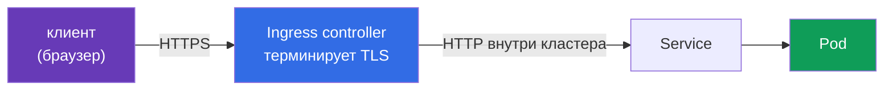

# Глава 4. Ingress с TLS

> **Что дальше.** Ingress - входная дверь в кластер из внешнего мира, и первая точка, где
> трафик пользователей встречается с вашей инфраструктурой. Если дверь открыта по HTTP,
> логины, токены и cookies идут по сети открытым текстом. В этой главе настроим TLS на
> Ingress, разберёмся с TLS-секретами, принудительным редиректом на HTTPS и посмотрим на
> Gateway API как на современную альтернативу.

## 4.1. Где терминируется TLS



Ingress-контроллер (nginx, Traefik, HAProxy, контроллеры облаков) принимает HTTPS,
расшифровывает его сертификатом из Secret и дальше проксирует в Service. Трафик от
контроллера до пода по умолчанию идёт открытым текстом внутри кластера - его защищают
mTLS/шифрованием pod-to-pod (глава 16).

## 4.2. TLS Secret

Сертификат и ключ хранятся в Secret типа `kubernetes.io/tls` с ключами `tls.crt` и `tls.key`.
Для практики сгенерируем самоподписанный сертификат:

```bash
openssl req -x509 -nodes -days 365 -newkey rsa:2048 \
  -keyout tls.key -out tls.crt \
  -subj "/CN=secure.example.com" \
  -addext "subjectAltName=DNS:secure.example.com"

kubectl -n web create secret tls secure-tls --cert=tls.crt --key=tls.key
kubectl -n web get secret secure-tls -o yaml   # type: kubernetes.io/tls
```

Secret должен находиться **в том же namespace, что и Ingress**.

## 4.3. Ingress с TLS

```yaml
apiVersion: networking.k8s.io/v1
kind: Ingress
metadata:
  name: secure
  namespace: web
  annotations:
    nginx.ingress.kubernetes.io/ssl-redirect: "true"   # HTTP -> HTTPS (для ingress-nginx)
spec:
  ingressClassName: nginx
  tls:
  - hosts:
    - secure.example.com
    secretName: secure-tls
  rules:
  - host: secure.example.com
    http:
      paths:
      - path: /
        pathType: Prefix
        backend:
          service:
            name: web
            port:
              number: 80
```

Важно:

- хост в `spec.tls[].hosts` должен совпадать с `rules[].host` и с SAN сертификата;
- если секрет не найден или невалиден, контроллер отдаёт свой **fake/default** сертификат -
  это частая причина «TLS вроде включён, но сертификат не тот»;
- у ingress-nginx при наличии секции `tls` редирект HTTP → HTTPS включён по умолчанию;
  аннотация `ssl-redirect` / `force-ssl-redirect` управляет им явно. Аннотации зависят от
  контроллера - смотрите документацию своего.

## 4.4. Проверка

```bash
# узнаём адрес контроллера (NodePort или LoadBalancer)
kubectl -n ingress-nginx get svc

# --resolve подставляет нужный host без правки DNS
curl -kv https://secure.example.com:<port>/ --resolve secure.example.com:<port>:<node-ip>

# посмотреть, какой сертификат реально отдаётся
openssl s_client -connect <node-ip>:<port> -servername secure.example.com </dev/null \
  | openssl x509 -noout -subject -issuer -dates

# редирект: ожидаем 308/301 на https
curl -I http://secure.example.com:<http-port>/ --resolve secure.example.com:<http-port>:<node-ip>
```

Флаг `-servername` (SNI) обязателен: без него контроллер не знает, какой сертификат отдать.

## 4.5. Ограничение версий TLS и шифров на контроллере

У ingress-nginx глобальные параметры задаются в ConfigMap контроллера:

```yaml
data:
  ssl-protocols: "TLSv1.2 TLSv1.3"
  ssl-ciphers: "ECDHE-ECDSA-AES128-GCM-SHA256:ECDHE-RSA-AES128-GCM-SHA256"
  hsts: "true"
```

HSTS заставляет браузер ходить только по HTTPS даже при ручном вводе `http://`.

## 4.6. Gateway API как альтернатива

Проект ingress-nginx объявил о прекращении развития (сопровождение в режиме best-effort до
марта 2026), и сообщество рекомендует переходить на **Gateway API**. Экзамен по-прежнему
проверяет классический Ingress, но полезно знать и эквивалент:

```yaml
apiVersion: gateway.networking.k8s.io/v1
kind: Gateway
metadata:
  name: web-gw
  namespace: web
spec:
  gatewayClassName: example
  listeners:
  - name: https
    protocol: HTTPS
    port: 443
    hostname: secure.example.com
    tls:
      mode: Terminate
      certificateRefs:
      - kind: Secret
        name: secure-tls
```

Маршрут описывается отдельным `HTTPRoute` с `parentRefs` на этот Gateway. Разделение ролей
(инфраструктура владеет Gateway и сертификатами, команды - маршрутами) - одно из
преимуществ Gateway API с точки зрения безопасности.

## 4.7. Best practices

- **Только HTTPS снаружи**: редирект с HTTP, HSTS, TLS 1.2+.
- **Автоматизируйте сертификаты** (cert-manager + ACME или корпоративный CA) - ручные
  сертификаты протухают.
- **Ограничьте доступ к TLS-секретам через RBAC**: ключ сертификата - это возможность
  выдавать себя за ваш сайт.
- **Не забывайте про трафик за контроллером** - шифруйте pod-to-pod (глава 16).
- **Проверяйте реально отдаваемый сертификат** через `openssl s_client -servername`.

## 4.8. Итоги главы

- TLS терминируется на Ingress-контроллере сертификатом из Secret `kubernetes.io/tls`.
- Secret - в namespace Ingress; хосты в `tls` и `rules` совпадают с SAN сертификата.
- Невалидный секрет → контроллер отдаёт default-сертификат.
- Редирект HTTP → HTTPS и HSTS - через аннотации/ConfigMap контроллера.
- Проверка - `curl --resolve` и `openssl s_client -servername`.
- Gateway API - современная замена Ingress с TLS в `listeners[].tls`.

## 4.9. Вопросы для самопроверки

1. Какие ключи должны быть в Secret типа `kubernetes.io/tls`?
2. Почему контроллер может отдавать «чужой» сертификат, хотя Ingress с `tls` создан?
3. Зачем нужен параметр `-servername` в `openssl s_client`?
4. Чем HSTS дополняет редирект HTTP → HTTPS?
5. Как выглядит TLS-терминация в Gateway API?

## Практика

Отдельной лабы по этой теме пока нет. Отработайте на любом кластере CKS с установленным
ingress-контроллером (например, лаба 01):

1. Создайте namespace `web`, Deployment `web` (`nginx`) и Service на порт 80.
2. Сгенерируйте сертификат для `secure.example.com` и создайте Secret `secure-tls`.
3. Создайте Ingress с TLS и принудительным редиректом.
4. Проверьте: `curl -k https://...` отдаёт страницу, `curl -I http://...` - редирект 308,
   `openssl s_client` показывает `CN=secure.example.com`.

🧪 Базовый кластер: [tasks/cks/labs/01](../../labs/01/README.MD)

---
[Оглавление](../README_RU.md) · [Глава 3](../03/ru.md) · [Глава 5](../05/ru.md)
