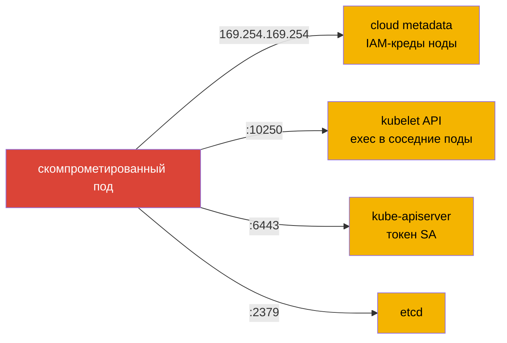

# Глава 5. Защита метаданных нод и эндпоинтов

> **Что дальше.** Под, захваченный атакующим, первым делом осматривается: что доступно по
> сети рядом? Самые лакомые цели - облачный metadata-сервис (там IAM-креды ноды), API
> kubelet (там можно выполнять команды в любых подах ноды) и сам kube-apiserver, если он
> торчит наружу. В этой главе закроем эти эндпоинты.

## 5.1. Карта чувствительных эндпоинтов

| Эндпоинт | Порт | Чем опасен |
|----------|------|------------|
| Cloud metadata (AWS/GCP/Azure) | `169.254.169.254:80` | IAM-креды ноды, user-data, bootstrap-токены |
| kubelet API | `10250` | exec/logs во всех подах ноды при слабой авторизации |
| kubelet read-only | `10255` | список подов, их env и спецификации без аутентификации |
| kube-apiserver | `6443` | весь кластер |
| etcd | `2379/2380` | все данные, включая secrets |
| controller-manager / scheduler | `10257/10259` | метрики/профилирование |
| NodePort-сервисы | `30000-32767` | всё, что вы случайно опубликовали |



## 5.2. Cloud metadata

Из любого пода в облаке по умолчанию можно сделать:

```bash
curl http://169.254.169.254/latest/meta-data/iam/security-credentials/<role>   # AWS IMDSv1
```

и получить временные ключи роли ноды. Как защищаться (defense-in-depth):

1. **NetworkPolicy с egress-исключением** `169.254.169.254/32` (глава 2) во всех прикладных
   namespace.
2. **Настройки облака**: в AWS - обязательный IMDSv2 (токен через PUT) и
   `HttpPutResponseHopLimit=1`, чтобы ответ не «доходил» до контейнера через дополнительный
   сетевой хоп. В GKE - Workload Identity / metadata concealment.
3. **Минимальная роль ноды** и отдельные роли для подов (IRSA / EKS Pod Identity, GKE
   Workload Identity) - глава 11.

Пример более узкой политики - запретить только metadata, разрешив всё остальное, - см. в
главе 2, раздел 2.5. Если в namespace уже действует default deny на egress, metadata и так
недоступна, пока вы её явно не разрешили.

## 5.3. kubelet API

kubelet на порту `10250` умеет `exec`, `run`, `logs`, `pods`. Если включены анонимный доступ
и режим `AlwaysAllow`, любой, кто достучался до порта, получает shell во всех подах ноды:

```bash
curl -sk https://<node-ip>:10250/pods                       # список подов
curl -sk -X POST "https://<node-ip>:10250/run/<ns>/<pod>/<container>" -d "cmd=id"
```

Закрываем в `/var/lib/kubelet/config.yaml` (глава 3):

```yaml
authentication:
  anonymous:
    enabled: false
  webhook:
    enabled: true
authorization:
  mode: Webhook
readOnlyPort: 0
```

Проверка после рестарта kubelet: анонимный запрос должен получать `401 Unauthorized`:

```bash
curl -sk https://<node-ip>:10250/pods   # Unauthorized
```

## 5.4. Доступ к kube-apiserver

- API не должен быть опубликован через **NodePort** или внешний LoadBalancer без
  необходимости. Сервис `kubernetes` в `default` должен быть `ClusterIP`.
- В облаке - приватный endpoint и allowlist источников (security groups, authorized
  networks).
- На нодах - файрвол, ограничивающий доступ к 6443 только с доверенных сетей.

```bash
kubectl get svc kubernetes -n default -o wide     # TYPE должен быть ClusterIP
```

Если кто-то поменял тип на NodePort - вернуть ClusterIP (и удалить `nodePort` из спеки).
Подробнее про ограничение доступа к API - глава 9.

## 5.5. Порты control plane

```bash
ss -tlpn | grep -E '6443|2379|2380|10250|10255|10257|10259'
```

Ожидаемая картина на kubeadm-кластере: `10257` и `10259` слушают `127.0.0.1`
(`--bind-address=127.0.0.1`), `10255` не слушается вообще, etcd доступен только с
control plane. Всё, что слушает `0.0.0.0` без необходимости, - кандидат на закрытие.

## 5.6. Узлы и их сетевой доступ извне

- Ноды не должны иметь публичных IP без необходимости; SSH - через bastion.
- NodePort-диапазон открывайте в файрволе только для реально публикуемых сервисов.
- Проверяйте, какие сервисы опубликованы: `kubectl get svc -A | grep -E 'NodePort|LoadBalancer'`.

## 5.7. Best practices

- **Закрыть metadata** на трёх уровнях: NetworkPolicy, настройки облака (IMDSv2, hop limit),
  минимальная роль ноды.
- **kubelet: anonymous off, Webhook, readOnlyPort 0** - на всех нодах.
- **API-сервер только через ClusterIP** внутри и приватный endpoint снаружи.
- **Control plane слушает на localhost** там, где внешний доступ не нужен.
- **Инвентаризация открытых портов** (`ss -tlpn`) - часть регулярного харденинга.

## 5.8. Итоги главы

- Главные цели атакующего рядом с подом: metadata `169.254.169.254`, kubelet `10250/10255`,
  apiserver `6443`, etcd `2379`.
- Metadata закрывается egress-политикой и настройками облака (IMDSv2, hop limit 1).
- kubelet: anonymous off, authorization Webhook, readOnlyPort 0 - проверка `401` на
  анонимный запрос.
- Сервис `kubernetes` - только ClusterIP; controller-manager/scheduler - на `127.0.0.1`.

## 5.9. Вопросы для самопроверки

1. Какие данные можно получить из cloud metadata и почему это опасно для всего аккаунта?
2. Зачем в AWS ставить `HttpPutResponseHopLimit=1`?
3. Что умеет атакующий, получивший анонимный доступ к порту 10250?
4. Как проверить, что kube-apiserver не опубликован через NodePort?
5. Какие порты control plane должны слушать только localhost?

## Практика

Верните доступ к kube-apiserver только через ClusterIP:

🧪 Лаба 03: [tasks/cks/labs/03](../../labs/03/README.MD)

Самостоятельно на том же кластере: создайте в namespace `default` egress-политику,
запрещающую `169.254.169.254`, и убедитесь из пода `curl -m 2 http://169.254.169.254`, что
запрос не проходит; проверьте анонимный доступ к kubelet
(`curl -sk https://<node-ip>:10250/pods`).

---
[Оглавление](../README_RU.md) · [Глава 4](../04/ru.md) · [Глава 6](../06/ru.md)
