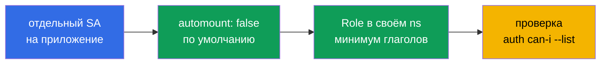

# Глава 8. ServiceAccount: осторожно с дефолтами

> **Что дальше.** Каждый под в Kubernetes - это ещё и субъект API: у него есть
> ServiceAccount и, по умолчанию, токен в файловой системе. Для атакующего, попавшего в
> контейнер, этот токен - первый ключ к API. В этой главе разберём, как устроены токены
> сегодня, как отключить их автомонтирование и как правильно выдавать права новым SA.

## 8.1. Как под получает токен

Если в спецификации пода не указан `serviceAccountName`, под получает SA `default` своего
namespace. Admission-контроллер ServiceAccount монтирует в каждый контейнер projected-volume:

```
/var/run/secrets/kubernetes.io/serviceaccount/
├── token        # JWT, привязанный к поду, с ограниченным сроком жизни
├── ca.crt       # CA кластера
└── namespace
```

Из контейнера этого достаточно, чтобы обратиться к API:

```bash
TOKEN=$(cat /var/run/secrets/kubernetes.io/serviceaccount/token)
curl -sk -H "Authorization: Bearer $TOKEN" https://kubernetes.default.svc/api/v1/namespaces/default/pods
```

Если у SA есть лишние права - атакующий их получил.

## 8.2. Bound-токены против legacy-токенов

| | Legacy (Secret `kubernetes.io/service-account-token`) | Bound (TokenRequest API) |
|---|---|---|
| Срок жизни | бессрочный | ограниченный (по умолчанию ~1 ч, ротируется kubelet) |
| Привязка | ни к чему | к поду/объекту: удалили под - токен недействителен |
| Audience | любая | задаётся (`aud`) |
| Хранение | в etcd, в Secret | только в памяти/томе пода |

С 1.24 Secret с токеном для SA **не создаётся автоматически**, а неиспользуемые legacy-токены
со временем помечаются и удаляются. Выпустить токен вручную:

```bash
kubectl -n dev create token ci --duration=10m
```

Создавать долгоживущий Secret-токен (`type: kubernetes.io/service-account-token` с
аннотацией `kubernetes.io/service-account.name`) стоит только если нет другого выхода.

## 8.3. Отключаем автомонтирование

Большинству приложений API Kubernetes не нужен вообще. Отключаем на уровне SA:

```yaml
apiVersion: v1
kind: ServiceAccount
metadata:
  name: default
  namespace: prod
automountServiceAccountToken: false
```

или на уровне пода (приоритет у пода):

```yaml
spec:
  serviceAccountName: web
  automountServiceAccountToken: false
```

Проверка:

```bash
kubectl -n prod exec deploy/web -- ls /var/run/secrets/kubernetes.io/serviceaccount
# ls: cannot access ...: No such file or directory
```

Изменения в SA действуют только на **новые** поды - существующие нужно пересоздать
(`kubectl rollout restart`).

## 8.4. Если токен всё-таки нужен

Если приложению нужен токен (например, для внешней системы с другой audience), монтируйте
его явно projected-томом с коротким сроком и конкретной audience:

```yaml
spec:
  serviceAccountName: vault-client
  automountServiceAccountToken: false
  containers:
  - name: app
    image: app:1.0
    volumeMounts:
    - name: vault-token
      mountPath: /var/run/secrets/tokens
      readOnly: true
  volumes:
  - name: vault-token
    projected:
      sources:
      - serviceAccountToken:
          path: vault-token
          audience: vault
          expirationSeconds: 600
```

## 8.5. Правила для новых SA



- **Свой SA на каждое приложение**, а не `default`: так права не «размазываются» по всем
  подам namespace, и в аудите видно, кто сделал запрос.
- **Не выдавайте прав SA `default`.** Любой под без явного SA их унаследует.
- **Права - Role в своём namespace**, ClusterRole - только когда без неё никак.
- **Проверка**: `kubectl auth can-i --list --as=system:serviceaccount:<ns>:<sa> -n <ns>`.

## 8.6. Поиск проблемных SA

```bash
# поды, у которых монтируется токен
kubectl get pods -A -o jsonpath='{range .items[*]}{.metadata.namespace}/{.metadata.name}{"\t"}{.spec.automountServiceAccountToken}{"\t"}{.spec.serviceAccountName}{"\n"}{end}'

# привязки к SA default
kubectl get rolebindings,clusterrolebindings -A -o wide | grep ':default'

# старые Secret-токены
kubectl get secrets -A --field-selector type=kubernetes.io/service-account-token
```

Классическая экзаменационная задача: «есть под с SA, который имеет лишние права / токен ему
не нужен - исправьте». Решение: создать отдельный SA с минимальной Role, отключить automount,
переключить Deployment на него, удалить лишние биндинги.

## 8.7. Итоги главы

- Под без явного SA получает `default`; токен монтируется в
  `/var/run/secrets/kubernetes.io/serviceaccount/`.
- Современные токены - bound: короткоживущие, привязанные к поду и audience.
- Legacy Secret-токены не создаются с 1.24; ручной токен - `kubectl create token`.
- `automountServiceAccountToken: false` на SA или поде (под приоритетнее); действует на новые
  поды.
- Отдельный SA на приложение, никаких прав у `default`, проверка через `auth can-i --list`.

## 8.8. Вопросы для самопроверки

1. Чем bound-токен безопаснее legacy-токена из Secret?
2. Где задать `automountServiceAccountToken: false` и что приоритетнее?
3. Почему после правки SA существующие поды всё ещё видят токен?
4. Как выдать приложению токен с audience `vault` и сроком 10 минут?
5. Почему опасно выдавать права SA `default`?

## Практика

Отдельной лабы по SA пока нет; задача **10 (Deployment security)** мок-экзамена включает
харденинг пода, в том числе SA:

🧪 Мок 01: [tasks/cks/mock/01](../../mock/01/README.MD)

Самостоятельно: в namespace `dev` создайте SA `ci` с правом только `list pods`, запретите
automount для SA `default`, пересоздайте под и проверьте, что токена нет, а `ci` не может
читать secrets.

---
[Оглавление](../README_RU.md) · [Глава 7](../07/ru.md) · [Глава 9](../09/ru.md)
