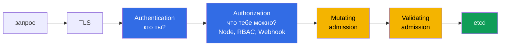

# Глава 9. Ограничение доступа к Kubernetes API

> **Что дальше.** Мы уже ограничили права (RBAC) и токены (SA). Теперь посмотрим на сам
> kube-apiserver как на точку входа: как проходит запрос, где его можно остановить, кто
> может достучаться до API анонимно и как закрыть лишние пути. Это центральная тема домена
> Cluster Hardening.

## 9.1. Путь запроса через API-сервер



Каждый этап - точка контроля:

- **Authentication**: клиентские сертификаты, токены SA, OIDC, webhook. Не прошедший
  аутентификацию запрос становится `system:anonymous` (если анонимный доступ включён) или
  получает `401`.
- **Authorization**: `--authorization-mode=Node,RBAC`. Режим `AlwaysAllow` недопустим.
- **Admission**: плагины и вебхуки, которые могут изменить или отклонить объект (PSS,
  NodeRestriction, ImagePolicyWebhook, Gatekeeper, ValidatingAdmissionPolicy).

## 9.2. Анонимный доступ

При `--anonymous-auth=true` (дефолт) запросы без учётных данных выполняются от
`system:anonymous` в группе `system:unauthenticated`. Опасно это, если кто-то дал этой группе
права:

```bash
kubectl get clusterrolebindings -o json | \
  jq -r '.items[] | select(.subjects[]?.name=="system:anonymous" or .subjects[]?.name=="system:unauthenticated") | .metadata.name'

curl -sk https://<api>:6443/api/v1/namespaces    # 403 - хорошо, 200 - катастрофа
```

Варианты защиты:

1. `--anonymous-auth=false` в `kube-apiserver.yaml`. Нюанс: kubeadm использует анонимные
   запросы для health-проб (`/livez`, `/readyz`) - при отключении пробы в манифесте могут
   падать, и их приходится переводить, например, на `tcpSocket`.
2. Современный способ (`AuthenticationConfiguration`, beta с 1.32, GA с 1.34): оставить
   анонимный доступ **только** для health-эндпоинтов:

```yaml
apiVersion: apiserver.config.k8s.io/v1   # в старых версиях - v1beta1
kind: AuthenticationConfiguration
anonymous:
  enabled: true
  conditions:
  - path: /livez
  - path: /readyz
  - path: /healthz
```

Подключается флагом `--authentication-config=<file>` (флаг `--anonymous-auth` одновременно с
ним не задаётся).

3. Убрать все биндинги для `system:anonymous` / `system:unauthenticated`, кроме встроенных
   `system:public-info-viewer`.

## 9.3. Устаревшие и опасные настройки

| Настройка | Что делать |
|-----------|-----------|
| `--insecure-port`, `--insecure-bind-address` | удалены из apiserver; если видите в старом манифесте - убрать |
| `--authorization-mode=AlwaysAllow` | заменить на `Node,RBAC` |
| `--token-auth-file` | статические токены - убрать (CIS 1.2.2) |
| `--enable-admission-plugins` без `NodeRestriction` | добавить `NodeRestriction` |
| `--kubelet-certificate-authority` не задан | задать `/etc/kubernetes/pki/ca.crt` |
| `--enable-admission-plugins=AlwaysAdmit` | убрать |

## 9.4. NodeRestriction

Admission-плагин `NodeRestriction` ограничивает kubelet (субъект `system:node:<name>`):
kubelet может менять только **свой** объект Node и поды, привязанные к нему, и **не может**
ставить на ноду метки с префиксом `node-restriction.kubernetes.io/`. Это не даёт
скомпрометированной ноде пометить себя как «доверенную» и притянуть к себе чувствительные
workload'ы.

```bash
grep enable-admission-plugins /etc/kubernetes/manifests/kube-apiserver.yaml
# --enable-admission-plugins=NodeRestriction
```

Проверка на воркере с kubeconfig kubelet:

```bash
export KUBECONFIG=/etc/kubernetes/kubelet.conf
kubectl label node <other-node> foo=bar                              # forbidden
kubectl label node $(hostname) node-restriction.kubernetes.io/x=y   # forbidden
```

## 9.5. Сетевой доступ к API

- Сервис `kubernetes` - только `ClusterIP` (не NodePort, не LoadBalancer) - глава 5.
- Внешний доступ - через приватный endpoint/VPN/bastion и allowlist источников.
- Для подов, которым API не нужен, - NetworkPolicy, запрещающая egress к IP apiserver, плюс
  отключённый токен (глава 8).

## 9.6. Как не сломать API при правке

1. Бэкап манифеста вне `/etc/kubernetes/manifests/`.
2. Правка, сохранение, ожидание (kubelet перечитывает манифест в течение ~20 с).
3. `watch crictl ps` - apiserver должен перезапуститься и остаться `Running`.
4. Если не поднимается: `crictl ps -a`, `crictl logs`, `/var/log/pods/kube-system_kube-apiserver-*`.
5. Опечатка в YAML → контейнер даже не создастся: смотрите `journalctl -u kubelet`.

Если нужно подключить файл конфигурации (аудит-политику, admission config, encryption
config), не забудьте **volume + volumeMount** в манифест - apiserver работает в контейнере и
не видит файлы хоста сам по себе.

## 9.7. Итоги главы

- Запрос проходит TLS → authentication → authorization → mutating → validating admission →
  etcd.
- Анонимный доступ: `--anonymous-auth=false` или `AuthenticationConfiguration` с
  анонимностью только для health-эндпоинтов; убрать биндинги на `system:anonymous`.
- Убрать AlwaysAllow, static token file, AlwaysAdmit; включить `Node,RBAC` и
  `NodeRestriction`.
- NodeRestriction ограничивает kubelet своей нодой и запрещает метки
  `node-restriction.kubernetes.io/`.
- Файлы конфигурации для apiserver подключаются через volume + volumeMount.

## 9.8. Вопросы для самопроверки

1. На каком этапе запрос анонимного пользователя получит отказ при `Node,RBAC` и отсутствии
   биндингов?
2. Какой побочный эффект у `--anonymous-auth=false` в кластере kubeadm?
3. Что запрещает NodeRestriction и почему это важно при компрометации ноды?
4. Почему после добавления флага с путём к файлу apiserver может не стартовать?
5. Как проверить, что сервис `kubernetes` не опубликован наружу?

## Практика

Закройте доступ к API через NodePort:

🧪 Лаба 03: [tasks/cks/labs/03](../../labs/03/README.MD)

Анонимный доступ в кластере kubeadm - задача **15 (kubeadm anonymous)**:

🧪 Мок 04: [tasks/cks/mock/04](../../mock/04/README.MD)

---
[Оглавление](../README_RU.md) · [Глава 8](../08/ru.md) · [Глава 10](../10/ru.md)
