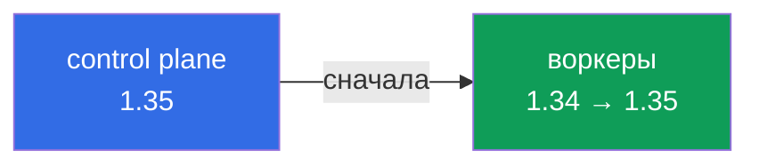

# Глава 10. Обновление Kubernetes для устранения уязвимостей

> **Что дальше.** Последняя тема Cluster Hardening. Уязвимости находят и в самом Kubernetes
> (apiserver, kubelet, kube-proxy), и единственное надёжное лечение - обновление. В этой
> главе вспомним процедуру апгрейда kubeadm-кластера из CKA, но с акцентом на безопасность:
> политика версий, порядок, откуда брать пакеты и как не оставить «хвосты».

## 10.1. Политика поддержки версий

- Kubernetes выпускает минорную версию примерно раз в 4 месяца.
- Поддерживаются (получают патчи безопасности) **три последние минорные версии**, каждая -
  около 14 месяцев.
- Патч-релизы (`1.35.0 → 1.35.1`) содержат исправления, в том числе CVE, и не ломают API.
- Уязвимости публикуются в официальном CVE feed на kubernetes.io и в анонсах
  `kubernetes-security-announce`.

Вывод: кластер на неподдерживаемой версии не получит исправлений - обновляться нужно
регулярно, а не «когда сломается».

## 10.2. Правила version skew



- Минорные версии обновляются **по одной**: `1.33 → 1.34 → 1.35`, перескакивать нельзя.
- Сначала control plane, потом ноды. kubelet не может быть новее kube-apiserver и может
  отставать от него до трёх минорных версий.
- `kubectl` - в пределах ±1 минорной версии от apiserver.

## 10.3. Репозиторий пакетов

Пакеты берутся из `pkgs.k8s.io`, и **каждая минорная версия - отдельный репозиторий**.
Чтобы обновиться на новую минорную, сначала меняем репозиторий:

```bash
cat /etc/apt/sources.list.d/kubernetes.list
# deb [signed-by=/etc/apt/keyrings/kubernetes-apt-keyring.gpg] https://pkgs.k8s.io/core:/stable:/v1.34/deb/ /
sed -i 's/v1.34/v1.35/' /etc/apt/sources.list.d/kubernetes.list
apt-get update
apt-cache madison kubeadm
```

Для патч-апгрейда в пределах минорной версии менять репозиторий не нужно.

## 10.4. Control plane

```bash
# на control plane
apt-mark unhold kubeadm
apt-get install -y kubeadm='1.35.1-1.1'
apt-mark hold kubeadm
kubeadm version

kubeadm upgrade plan
kubeadm upgrade apply v1.35.1       # на первом control plane
# на остальных control plane: kubeadm upgrade node

kubectl drain <cp-node> --ignore-daemonsets
apt-mark unhold kubelet kubectl
apt-get install -y kubelet='1.35.1-1.1' kubectl='1.35.1-1.1'
apt-mark hold kubelet kubectl
systemctl daemon-reload && systemctl restart kubelet
kubectl uncordon <cp-node>
```

## 10.5. Воркеры

```bash
# с машины, где есть kubectl
kubectl drain <worker> --ignore-daemonsets --delete-emptydir-data

# на воркере (ssh)
apt-mark unhold kubeadm && apt-get install -y kubeadm='1.35.1-1.1' && apt-mark hold kubeadm
kubeadm upgrade node
apt-mark unhold kubelet kubectl
apt-get install -y kubelet='1.35.1-1.1' kubectl='1.35.1-1.1'
apt-mark hold kubelet kubectl
systemctl daemon-reload && systemctl restart kubelet

# обратно
kubectl uncordon <worker>
kubectl get nodes -o wide
```

## 10.6. Безопасность в процессе апгрейда

- **Бэкап etcd** перед апгрейдом (`etcdctl snapshot save`) - это ваш план отката.
- **Проверяйте, что апгрейд не откатил харденинг.** `kubeadm upgrade apply` перегенерирует
  static pod манифесты. Флаги, добавленные вручную, kubeadm переносит, но если они были
  заданы не через `ClusterConfiguration`, проверьте манифесты и снова прогоните kube-bench.
- **Сертификаты**: `kubeadm upgrade` по умолчанию обновляет сертификаты control plane
  (`kubeadm certs check-expiration`).
- **Не забудьте про компоненты вне kubeadm**: CNI, CoreDNS, ingress-контроллер, containerd,
  ядро ОС - у них свои CVE.
- **Удаление устаревших API** проверяйте до апгрейда (Deprecated API Migration Guide).

## 10.7. Итоги главы

- Поддерживаются три последние минорные версии; патчи содержат исправления CVE.
- Обновление - по одной минорной версии, сначала control plane, затем ноды.
- Для новой минорной версии меняется репозиторий `pkgs.k8s.io`.
- Порядок: kubeadm → `upgrade plan/apply` (или `upgrade node`) → drain → kubelet/kubectl →
  restart → uncordon.
- До апгрейда - бэкап etcd; после - проверка, что харденинг на месте.

## 10.8. Вопросы для самопроверки

1. Сколько минорных версий поддерживается одновременно?
2. Можно ли обновиться с 1.33 сразу на 1.35? Почему?
3. Почему при переходе на новую минорную версию нужно менять apt-репозиторий?
4. Чем отличаются `kubeadm upgrade apply` и `kubeadm upgrade node`?
5. Что нужно проверить после апгрейда с точки зрения безопасности?

## Практика

Обновите кластер с помощью kubeadm и apt:

🧪 Лаба 20: [tasks/cks/labs/20](../../labs/20/README.MD)

Задача **11 (update cluster)**:

🧪 Мок 04: [tasks/cks/mock/04](../../mock/04/README.MD)

---
[Оглавление](../README_RU.md) · [Глава 9](../09/ru.md) · [Глава 11](../11/ru.md)
