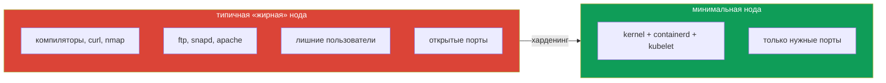

# Глава 11. Харденинг ОС хоста, IAM и внешний сетевой доступ

> **Что дальше.** Открываем домен **System Hardening (10%)**. Нода - это Linux, и если
> атакующий сбежал из контейнера, всё, что установлено и запущено на ноде, становится его
> инструментарием. В этой главе уменьшим поверхность атаки хоста: лишние пакеты и сервисы,
> открытые порты, пользователи и права, модули ядра, IAM-роли нод и внешний сетевой доступ.

## 11.1. Принцип: на ноде только то, что нужно Kubernetes

Нода кластера - не универсальный сервер. Ей нужны: ядро, container runtime, kubelet, CNI,
агенты мониторинга/логирования. Всё остальное - поверхность атаки:



Идеал - специализированные ОС для контейнеров (Bottlerocket, Flatcar, Talos): read-only
rootfs, нет пакетного менеджера и shell. На экзамене работаем с обычной Ubuntu и
«отрезаем» лишнее вручную.

## 11.2. Сервисы и пакеты

```bash
systemctl list-units --type=service --state=running
systemctl list-unit-files --state=enabled

# остановить и отключить ненужный сервис
systemctl disable --now apache2
systemctl mask apache2          # запретить запуск даже как зависимость

# найти и удалить пакет
dpkg -l | grep -i ftp
apt-get purge -y vsftpd
```

Задача на экзамене может звучать как «найдите и отключите сервис, слушающий порт X» -
связываем порт с процессом, процесс с юнитом, юнит с пакетом:

```bash
ss -tlpn | grep 21
# LISTEN 0 32 0.0.0.0:21 ... users:(("vsftpd",pid=812,fd=3))
systemctl status 812            # покажет юнит по PID
dpkg -S $(readlink -f /proc/812/exe)   # какой пакет установил бинарник
```

## 11.3. Открытые порты

```bash
ss -tulpn                # TCP/UDP, слушающие сокеты, процессы
lsof -i -P -n | grep LISTEN
netstat -tulpn           # если есть net-tools
```

Для каждого слушающего порта ответьте: кому он нужен и должен ли слушать `0.0.0.0` или
достаточно `127.0.0.1`?

## 11.4. Пользователи и привилегии на хосте

```bash
cat /etc/passwd | awk -F: '$3 >= 1000 {print $1, $7}'     # «человеческие» пользователи
getent group sudo docker
cat /etc/sudoers /etc/sudoers.d/*

userdel -r olduser                 # удалить пользователя
gpasswd -d developer docker        # убрать из группы docker (= root на хосте)
usermod -s /usr/sbin/nologin svc   # запретить интерактивный вход
```

Членство в группе `docker` или доступ к `/var/run/docker.sock` / `containerd.sock` - это
root на ноде: можно запустить privileged-контейнер с примонтированным `/`. Подробнее о
харденинге Docker - в главе 17.

SSH: вход по ключам, `PermitRootLogin no`, `PasswordAuthentication no` в
`/etc/ssh/sshd_config`.

## 11.5. Модули ядра

Лишние модули ядра расширяют поверхность атаки (исторически - уязвимости в `dccp`, `sctp`,
`rds`). Запрет загрузки:

```bash
lsmod | grep -E 'dccp|sctp'
cat <<CONF > /etc/modprobe.d/blacklist-rare-network.conf
install dccp /bin/false
install sctp /bin/false
blacklist dccp
blacklist sctp
CONF
rmmod dccp 2>/dev/null
```

Важно: запрос из контейнера на сокет редкого протокола может заставить ядро **автоматически
загрузить** модуль. Blacklist этого не допустит.

## 11.6. Least-privilege IAM для нод и подов

В облаке у ноды есть IAM-роль. Всё, что может роль, может любой процесс на ноде - а через
metadata и любой под (глава 5).

- **Минимальная роль ноды**: только то, что нужно kubelet и CNI (pull образов, attach
  томов). Никаких `s3:*` или `AdministratorAccess`.
- **Роли для подов - отдельно**: IRSA / EKS Pod Identity (AWS), Workload Identity (GKE,
  AKS). Под получает роль через свой SA, а не через ноду.
- **Закрыть metadata** для подов (NetworkPolicy + IMDSv2 hop limit 1).
- **Внутри кластера** тот же принцип обеспечивает RBAC (главы 7-8), на хосте - отсутствие
  лишних пользователей и sudo.

## 11.7. Минимизация внешнего сетевого доступа

- **Файрвол на ноде** (`ufw`, `nftables`/`iptables`) или security groups в облаке: входящие
  только необходимые порты (6443 с доверенных сетей, 10250 от control plane, NodePort только
  при необходимости, SSH с bastion).
- **Egress из кластера** - через NAT/egress gateway и allowlist, а внутри - NetworkPolicy.
- **Не публикуйте сервисы без необходимости**: `kubectl get svc -A` - проверьте NodePort и
  LoadBalancer.

```bash
ufw default deny incoming
ufw allow from 10.0.0.0/16 to any port 10250 proto tcp
ufw allow 22/tcp
ufw enable
ufw status verbose
```

Осторожно: неверное правило файрвола может отрезать kubelet от apiserver или CNI-трафик
между нодами.

## 11.8. Best practices

- **Минимальная ОС** для нод, в идеале - контейнерно-ориентированная.
- **Удалить/отключить** лишние пакеты и сервисы, закрыть лишние порты.
- **Никаких людей в группе docker**, SSH только по ключам, без root-логина.
- **Blacklist редких модулей ядра**.
- **IAM: минимальная роль ноды + роли для подов через SA**.
- **Файрвол на входе и контролируемый egress**.

## 11.9. Итоги главы

- Нода - поверхность атаки после побега из контейнера; на ней только нужное Kubernetes.
- Сервисы: `systemctl disable --now`, `mask`; пакеты: `apt-get purge`.
- Цепочка «порт → PID → юнит → пакет»: `ss -tlpn`, `systemctl status <pid>`, `dpkg -S`.
- Группа docker и сокет runtime = root; пользователей и sudo минимизируем.
- Лишние модули ядра - в blacklist через `/etc/modprobe.d/`.
- IAM: минимальная роль ноды, роли подов через IRSA/Workload Identity.
- Внешний доступ ограничивается файрволом/SG и отказом от ненужных NodePort/LB.

## 11.10. Вопросы для самопроверки

1. Как найти пакет, которому принадлежит процесс, слушающий порт 21?
2. Чем `systemctl mask` отличается от `systemctl disable`?
3. Почему членство в группе docker эквивалентно root?
4. Зачем блокировать модули `dccp`/`sctp`, если их никто не использует?
5. Почему роль ноды в облаке должна быть минимальной, и чем её заменить для подов?

## Практика

Харденинг Docker-демона и доступа к нему:

🧪 Лаба 29: [tasks/cks/labs/29](../../labs/29/README.MD)

Самостоятельно на воркере любой лабы: найдите все слушающие порты, определите для каждого
процесс и пакет, отключите всё, что не нужно Kubernetes; добавьте blacklist для `dccp`.

---
[Оглавление](../README_RU.md) · [Глава 10](../10/ru.md) · [Глава 12](../12/ru.md)
