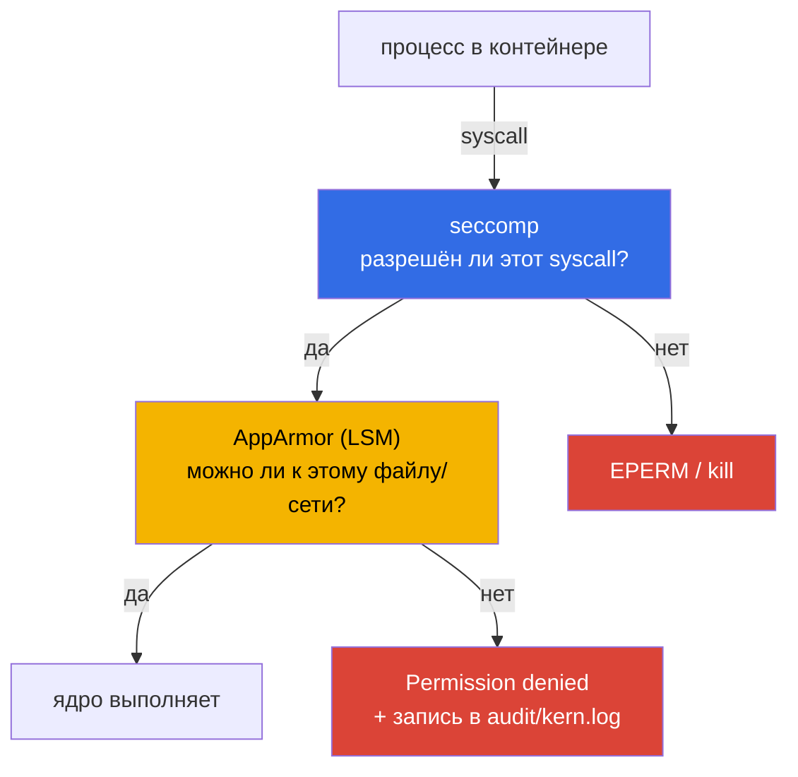

# Глава 12. Харденинг ядра: AppArmor и seccomp

> **Что дальше.** Контейнер - это обычный процесс Linux, и он разговаривает с тем же ядром,
> что и хост. Значит, ограничивать надо и то, **к чему** процесс может обращаться (файлы,
> сеть, capabilities), и то, **какие системные вызовы** он может делать. Для первого есть
> AppArmor, для второго - seccomp. Это одна из самых «экзаменационных» тем курса.

## 12.1. Где работают AppArmor и seccomp



| | seccomp | AppArmor |
|---|---|---|
| Что ограничивает | набор системных вызовов | доступ к путям, сети, capabilities |
| Где профиль | JSON-файл на ноде | загружен в ядро через `apparmor_parser` |
| Где задаётся в поде | `securityContext.seccompProfile` | `securityContext.appArmorProfile` |
| Дефолт в Kubernetes | Unconfined (если не включён `--seccomp-default`) | `runtime/default` у containerd |

## 12.2. AppArmor: профили и режимы

Профиль AppArmor описывает, что разрешено процессу. Режимы:

- **enforce** - нарушения блокируются и логируются;
- **complain** - нарушения только логируются (для отладки и создания профиля).

```bash
aa-status                                  # загруженные профили и их режимы
apparmor_parser -q /etc/apparmor.d/k8s-deny-write     # загрузить (или обновить -r)
apparmor_parser -r /etc/apparmor.d/k8s-deny-write
```

Пример профиля, запрещающего запись везде:

```
#include <tunables/global>

profile k8s-deny-write flags=(attach_disconnected) {
  #include <abstractions/base>
  file,
  deny /** w,
}
```

**Имя профиля** - это строка после `profile`, а не имя файла. Его и указываем в поде.

Профиль должен быть загружен **на каждой ноде**, где может запуститься под. Если профиля нет,
под останется в статусе `Blocked` / `CreateContainerError`. Поэтому часто задача звучит как
«загрузите профиль на ноду X, пометьте ноду меткой и привяжите Deployment к ней через
nodeSelector».

## 12.3. AppArmor в поде

Начиная с Kubernetes 1.30 AppArmor задаётся полем `securityContext` (аннотации
`container.apparmor.security.beta.kubernetes.io/<container>` устарели):

```yaml
apiVersion: apps/v1
kind: Deployment
metadata:
  name: apparmor
  namespace: apparmor
spec:
  replicas: 1
  selector:
    matchLabels:
      app: apparmor
  template:
    metadata:
      labels:
        app: apparmor
    spec:
      nodeSelector:
        security: apparmor
      containers:
      - name: c1
        image: nginx:1.27
        securityContext:
          appArmorProfile:
            type: Localhost              # RuntimeDefault | Localhost | Unconfined
            localhostProfile: k8s-deny-write
```

Проверка:

```bash
kubectl -n apparmor logs deploy/apparmor          # nginx не сможет писать - ошибки в логе
kubectl -n apparmor exec deploy/apparmor -- cat /proc/1/attr/current
# k8s-deny-write (enforce)
crictl inspect <container-id> | grep -i apparmor
```

Если задача требует профиль из файла на ноде - сначала `scp`/`ssh` на ноду, `apparmor_parser`,
затем метка на ноду `kubectl label node <node> security=apparmor`.

## 12.4. seccomp: профили

seccomp-профиль - JSON с действием по умолчанию и списком системных вызовов:

```json
{
  "defaultAction": "SCMP_ACT_ERRNO",
  "architectures": ["SCMP_ARCH_X86_64"],
  "syscalls": [
    {
      "names": ["read", "write", "exit", "exit_group", "futex", "epoll_wait", "accept4"],
      "action": "SCMP_ACT_ALLOW"
    }
  ]
}
```

Действия: `SCMP_ACT_ALLOW`, `SCMP_ACT_ERRNO` (вернуть ошибку), `SCMP_ACT_KILL_PROCESS`,
`SCMP_ACT_LOG` (только записать в лог - удобно для построения профиля).

Локальные профили kubelet ищет относительно каталога **`/var/lib/kubelet/seccomp/`**:

```bash
mkdir -p /var/lib/kubelet/seccomp/profiles
cp /var/work/profile-nginx.json /var/lib/kubelet/seccomp/profiles/nginx.json
```

## 12.5. seccomp в поде

```yaml
apiVersion: v1
kind: Pod
metadata:
  name: seccomp-nginx
spec:
  securityContext:                 # на уровне пода - для всех контейнеров
    seccompProfile:
      type: Localhost              # RuntimeDefault | Localhost | Unconfined
      localhostProfile: profiles/nginx.json   # путь ОТНОСИТЕЛЬНО /var/lib/kubelet/seccomp/
  containers:
  - name: nginx
    image: nginx:1.27
```

Для большинства workload'ов достаточно `type: RuntimeDefault` - профиля runtime, который
блокирует десятки опасных вызовов (`mount`, `kexec_load`, `ptrace` и др.). Это же требование
PSS `restricted` (глава 13).

Проверка:

```bash
kubectl get pod seccomp-nginx                    # Running или CreateContainerError
kubectl exec seccomp-nginx -- grep Seccomp /proc/1/status
# Seccomp: 2    (0 - выключен, 2 - filter)
```

Если профиль слишком строгий, контейнер упадёт на старте - смотрите `kubectl describe pod` и
`crictl logs`.

## 12.6. RuntimeDefault для всех подов ноды

kubelet умеет применять `RuntimeDefault` ко всем подам, которые не указали профиль явно:

```yaml
# /var/lib/kubelet/config.yaml
seccompDefault: true
```

(или флаг `--seccomp-default`). После рестарта kubelet новые поды получат профиль runtime.

## 12.7. Отладка и логи

```bash
dmesg | grep -i -E 'apparmor|audit'
journalctl -k | grep -i 'apparmor="DENIED"'
grep -i seccomp /var/log/syslog
```

Запись вида `apparmor="DENIED" operation="open" profile="k8s-deny-write" name="/tmp/x"`
сразу показывает, какой профиль и что заблокировал.

## 12.8. Best practices

- **RuntimeDefault seccomp для всех подов** - через `seccompDefault` kubelet или PSS
  restricted.
- **Свои AppArmor/seccomp профили** - для чувствительных workload'ов; строить их в
  complain/`SCMP_ACT_LOG`, затем переводить в enforce.
- **Профили на всех нодах**, где может оказаться под: DaemonSet-загрузчик или
  Security Profiles Operator; иначе - nodeSelector.
- **Никогда не `Unconfined`** в продакшне без явного обоснования.

## 12.9. Итоги главы

- seccomp ограничивает системные вызовы, AppArmor - доступ к файлам, сети, capabilities.
- AppArmor: `apparmor_parser` загружает профиль, `aa-status` показывает; имя - из строки
  `profile`.
- В поде: `securityContext.appArmorProfile.type: Localhost` + `localhostProfile` (с 1.30).
- seccomp: профиль в `/var/lib/kubelet/seccomp/`, в поде - путь относительно этого каталога.
- `RuntimeDefault` - разумный минимум; `seccompDefault: true` в kubelet включает его везде.
- Проверка: `/proc/1/attr/current`, `grep Seccomp /proc/1/status`, `dmesg`.

## 12.10. Вопросы для самопроверки

1. Какую задачу решает seccomp, а какую AppArmor?
2. Откуда берётся имя AppArmor-профиля, которое указывают в поде?
3. Что произойдёт с подом, если AppArmor-профиль не загружен на ноде?
4. Относительно какого каталога указывается `localhostProfile` для seccomp?
5. Как включить RuntimeDefault для всех подов ноды?
6. Как проверить, что в контейнере активен seccomp-фильтр?

## Практика

Загрузите AppArmor-профиль на ноду и запустите с ним Deployment:

🧪 Лаба 09: [tasks/cks/labs/09](../../labs/09/README.MD)

Под с seccomp-профилем из файла на ноде - задача **18**:

🧪 Мок 01: [tasks/cks/mock/01](../../mock/01/README.MD)

---
[Оглавление](../README_RU.md) · [Глава 11](../11/ru.md) · [Глава 13](../13/ru.md)
