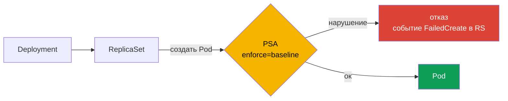

# Глава 13. Pod Security Standards и securityContext

> **Что дальше.** Открываем домен **Minimize Microservice Vulnerabilities (20%)**. Большинство
> побегов из контейнера начинаются с того, что под запущен с избыточными правами:
> privileged, hostPath на `/`, hostPID, root, лишние capabilities. В этой главе разберём
> securityContext - как «правильно» описать под - и Pod Security Standards с Pod Security
> Admission - как запретить «неправильные» поды на уровне namespace.

## 13.1. Опасные настройки пода

| Настройка | Чем опасна |
|-----------|-----------|
| `privileged: true` | все capabilities и доступ к устройствам хоста - почти root на ноде |
| `hostPID: true` | видит все процессы ноды, может `nsenter` в них |
| `hostNetwork: true` | сеть ноды: слушает порты хоста, видит трафик, обходит NetworkPolicy |
| `hostIPC: true` | общая IPC с хостом |
| `hostPath` | прямой доступ к файлам ноды (`/`, `/var/run/containerd.sock`, `/etc`) |
| `runAsUser: 0` / нет `runAsNonRoot` | root в контейнере - root на хосте при побеге |
| `allowPrivilegeEscalation: true` | setuid-бинарники могут поднять права |
| `capabilities.add: [SYS_ADMIN, NET_ADMIN, ...]` | `SYS_ADMIN` - почти privileged |
| запись в rootfs | атакующий может скачать и положить инструменты |

Классический побег: под с `hostPID: true` и `privileged: true` → `nsenter -t 1 -m -u -i -n -p -- bash`
- и вы в shell хоста.

## 13.2. securityContext: безопасный шаблон

```yaml
apiVersion: apps/v1
kind: Deployment
metadata:
  name: secure-app
spec:
  selector:
    matchLabels:
      app: secure-app
  template:
    metadata:
      labels:
        app: secure-app
    spec:
      automountServiceAccountToken: false
      securityContext:                    # уровень пода
        runAsNonRoot: true
        runAsUser: 10001
        runAsGroup: 10001
        fsGroup: 10001
        seccompProfile:
          type: RuntimeDefault
      containers:
      - name: app
        image: registry.example.com/app:1.2.3
        securityContext:                  # уровень контейнера (приоритетнее)
          allowPrivilegeEscalation: false
          privileged: false
          readOnlyRootFilesystem: true
          capabilities:
            drop: ["ALL"]
            # add: ["NET_BIND_SERVICE"]   # только если реально нужно
        volumeMounts:
        - name: tmp
          mountPath: /tmp
      volumes:
      - name: tmp
        emptyDir: {}
```

Нюансы:

- поле на уровне контейнера **перекрывает** такое же поле на уровне пода;
- `privileged`, `capabilities`, `allowPrivilegeEscalation`, `readOnlyRootFilesystem` есть
  **только** на уровне контейнера;
- `runAsNonRoot: true` проверяется в рантайме: если образ хочет запускаться от UID 0,
  контейнер не стартует (`CreateContainerConfigError`). Задайте `runAsUser` или
  исправьте образ (глава 17);
- при `readOnlyRootFilesystem: true` приложению почти всегда нужен `emptyDir` для `/tmp`
  и кешей (глава 24).

## 13.3. Pod Security Standards

**Pod Security Standards (PSS)** - три уровня политики, описанные в документации Kubernetes:

| Уровень | Смысл | Что запрещено (кратко) |
|---------|-------|------------------------|
| `privileged` | без ограничений | ничего |
| `baseline` | запрет известных эскалаций | privileged, hostPID/IPC/Network, hostPath, hostPort, опасные capabilities, небезопасные sysctl, AppArmor/SELinux-обход |
| `restricted` | жёсткий best practice | всё из baseline + обязателен `runAsNonRoot`, `allowPrivilegeEscalation: false`, `capabilities.drop: [ALL]` (разрешён add только `NET_BIND_SERVICE`), seccomp `RuntimeDefault`/`Localhost`, ограниченные типы томов |

PodSecurityPolicy (PSP) удалена в 1.25; её заменил встроенный **Pod Security Admission
(PSA)**, реализующий PSS.

## 13.4. Pod Security Admission: метки namespace

PSA включается метками на namespace. Три режима:

| Режим | Что происходит при нарушении |
|-------|------------------------------|
| `enforce` | под отклоняется |
| `audit` | под создаётся, в аудит-лог пишется аннотация |
| `warn` | под создаётся, пользователь видит предупреждение |

```bash
kubectl label ns team-red \
  pod-security.kubernetes.io/enforce=baseline \
  pod-security.kubernetes.io/enforce-version=latest \
  pod-security.kubernetes.io/warn=restricted \
  pod-security.kubernetes.io/audit=restricted
```



Важная особенность: PSA проверяет **поды**, а не Deployment. Deployment с нарушением
создастся успешно, но его ReplicaSet не сможет создать поды - ошибка видна в событиях RS:

```bash
kubectl -n team-red get rs
kubectl -n team-red describe rs <rs-name>        # Events: FailedCreate ... violates PodSecurity
kubectl -n team-red get events --field-selector reason=FailedCreate
```

Также при навешивании метки `enforce` уже работающие поды **не удаляются** - kubectl только
выводит предупреждение о существующих нарушителях. Чтобы проверить, что будет:

```bash
kubectl label --dry-run=server --overwrite ns team-red pod-security.kubernetes.io/enforce=restricted
```

## 13.5. Кластерный дефолт PSA

Уровни по умолчанию для всех namespace без меток задаются конфигом admission-плагина
`PodSecurity`:

```yaml
apiVersion: apiserver.config.k8s.io/v1
kind: AdmissionConfiguration
plugins:
- name: PodSecurity
  configuration:
    apiVersion: pod-security.admission.config.k8s.io/v1
    kind: PodSecurityConfiguration
    defaults:
      enforce: baseline
      enforce-version: latest
      audit: restricted
      warn: restricted
    exemptions:
      namespaces: [kube-system]
```

Подключается флагом `--admission-control-config-file` kube-apiserver (с volume + volumeMount).

## 13.6. Когда PSS мало

PSS - фиксированные уровни. Для правил вроде «только образы из нашего реестра», «обязательна
метка team», «запрещён тег latest» нужны политики: **ValidatingAdmissionPolicy** (встроенная,
CEL), **OPA Gatekeeper**, **Kyverno** - глава 19.

## 13.7. Best practices

- **`restricted` для прикладных namespace**, `baseline` - минимум для всех, `privileged` -
  только для системных (CNI, CSI, мониторинг нод).
- **Внедряйте через `warn`/`audit`**, затем включайте `enforce`.
- **Пиньте версию** (`enforce-version`) в продакшне, чтобы апгрейд Kubernetes не изменил
  правила неожиданно.
- **Шаблон securityContext** из 13.2 - по умолчанию для всех своих манифестов.
- **Проверяйте события ReplicaSet**, когда «Deployment есть, а подов нет».

## 13.8. Итоги главы

- Главные опасности: privileged, host-namespaces, hostPath, root, capabilities, escalation.
- securityContext на уровне контейнера перекрывает уровень пода; часть полей - только у
  контейнера.
- PSS: privileged / baseline / restricted. PSP удалена, её заменил PSA.
- PSA - метки namespace `pod-security.kubernetes.io/<enforce|audit|warn>=<level>`.
- PSA проверяет поды: нарушение Deployment видно в событиях ReplicaSet.
- Существующие поды при включении enforce не удаляются.

## 13.9. Вопросы для самопроверки

1. Как под с `hostPID` и `privileged` превращается в shell на ноде?
2. Какие поля securityContext доступны только на уровне контейнера?
3. Чем `baseline` отличается от `restricted`?
4. Почему Deployment создаётся, а подов нет, и где искать причину?
5. Что произойдёт с уже запущенными подами после метки `enforce=restricted`?
6. Как задать уровень PSA по умолчанию для всех namespace?

## Практика

Включите enforce baseline и найдите события ReplicaSet:

🧪 Лаба 04: [tasks/cks/labs/04](../../labs/04/README.MD)

Харденинг Deployment через securityContext - задача **10 (Deployment security)**, PSS - задача
**15**:

🧪 Мок 01: [tasks/cks/mock/01](../../mock/01/README.MD)

---
[Оглавление](../README_RU.md) · [Глава 12](../12/ru.md) · [Глава 14](../14/ru.md)
