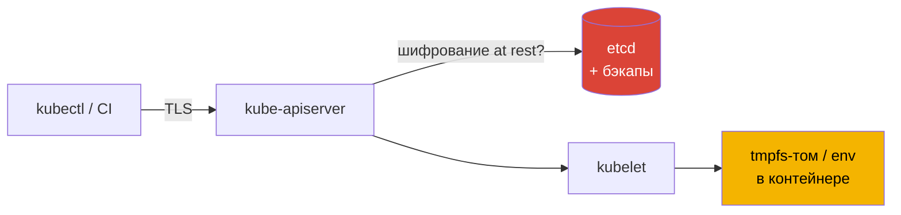
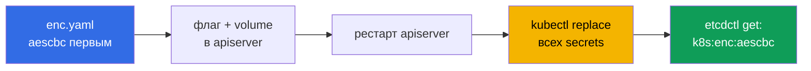

# Глава 14. Управление секретами Kubernetes

> **Что дальше.** Secret - самый ценный объект кластера: пароли баз, API-ключи, TLS-ключи,
> токены. При этом по умолчанию он хранится в etcd в base64, то есть фактически открытым
> текстом. В этой главе разберём, где и как секреты могут утечь, научимся читать их прямо из
> etcd (как атакующий), включим шифрование at rest и обсудим внешние хранилища.

## 14.1. Где живёт секрет и где он может утечь



Точки утечки:

- **etcd и его бэкапы** - без шифрования at rest секреты читаются напрямую;
- **RBAC** - `get/list/watch` на secrets, а также `create pods` (глава 7);
- **переменные окружения** - попадают в `kubectl describe`, дампы процессов, логи
  аварийных падений, `/proc/<pid>/environ`;
- **Git и манифесты** - base64 не шифрование;
- **нода** - секреты подов ноды лежат в tmpfs, root на ноде читает их все.

## 14.2. base64 - это не шифрование

```bash
kubectl -n team-green get secret database-access -o jsonpath='{.data.pass}' | base64 -d
```

Любой, кто может прочитать объект, видит значение. Защита секретов - это RBAC + шифрование
хранилища + аккуратное использование в подах.

## 14.3. Чтение секрета напрямую из etcd

Так делает атакующий, получивший доступ к control plane или к бэкапу etcd. Сертификаты
клиента etcd берём у apiserver:

```bash
ETCDCTL_API=3 etcdctl \
  --endpoints=https://127.0.0.1:2379 \
  --cacert=/etc/kubernetes/pki/etcd/ca.crt \
  --cert=/etc/kubernetes/pki/apiserver-etcd-client.crt \
  --key=/etc/kubernetes/pki/apiserver-etcd-client.key \
  get /registry/secrets/team-green/database-access
```

Путь ключа: `/registry/secrets/<namespace>/<name>`. Если шифрование не включено, в выводе
видно значения открытым текстом (в protobuf-обёртке). Если включено - префикс вида
`k8s:enc:aescbc:v1:key1:` и нечитаемые байты.

Если `etcdctl` на хосте нет, его можно вызвать внутри пода etcd:

```bash
kubectl -n kube-system exec etcd-<cp-node> -- etcdctl \
  --cacert=/etc/kubernetes/pki/etcd/ca.crt \
  --cert=/etc/kubernetes/pki/etcd/server.crt \
  --key=/etc/kubernetes/pki/etcd/server.key \
  get /registry/secrets/team-green/database-access
```

## 14.4. Шифрование at rest

Конфигурация `EncryptionConfiguration`:

```yaml
# /etc/kubernetes/enc/enc.yaml
apiVersion: apiserver.config.k8s.io/v1
kind: EncryptionConfiguration
resources:
- resources:
  - secrets
  providers:
  - aescbc:                         # первый провайдер - им ШИФРУЮТСЯ новые записи
      keys:
      - name: key1
        secret: MTIzNDU2Nzg5MDEyMzQ1Ng==    # base64 от 16/24/32 байт
  - identity: {}                    # позволяет читать ещё не зашифрованные данные
```

Ключ генерируется так: `head -c 32 /dev/urandom | base64`.

Провайдеры:

| Провайдер | Комментарий |
|-----------|-------------|
| `identity` | без шифрования |
| `aescbc`, `aesgcm`, `secretbox` | локальный ключ в файле на control plane |
| `kms` (v2) | ключ шифрования ключей во внешнем KMS - рекомендуемый вариант для продакшна |

**Порядок важен**: запись идёт первым провайдером, чтение - любым подходящим. Если первым
стоит `identity`, ничего шифроваться не будет.

Подключаем к apiserver (флаг + volume + volumeMount):

```yaml
spec:
  containers:
  - command:
    - kube-apiserver
    - --encryption-provider-config=/etc/kubernetes/enc/enc.yaml
    volumeMounts:
    - name: enc
      mountPath: /etc/kubernetes/enc
      readOnly: true
  volumes:
  - name: enc
    hostPath:
      path: /etc/kubernetes/enc
      type: DirectoryOrCreate
```

## 14.5. Перешифровка существующих секретов

Конфигурация влияет только на **новые записи**. Уже сохранённые секреты остаются как были,
пока их не перезапишут:

```bash
# все секреты кластера
kubectl get secrets -A -o json | kubectl replace -f -
# только namespace stage
kubectl -n stage get secrets -o json | kubectl replace -f -
```

Проверка через etcdctl (раздел 14.3): в значении должен появиться префикс
`k8s:enc:aescbc:v1:key1`.



Ротация ключа: добавить новый ключ вторым → рестарт на всех apiserver → переставить его
первым → рестарт → перезаписать все секреты → удалить старый ключ.

## 14.6. Безопасное использование секретов в подах

- **Тома, а не переменные окружения**: том - tmpfs, обновляется при изменении секрета, не
  светится в `describe` и `environ`.
- **`readOnly: true` и `defaultMode: 0400`** на томе.
- **Только нужные ключи** через `items`, а не весь Secret.
- **Immutable secrets** (`immutable: true`) для редко меняющихся значений - защита от
  случайной подмены и снижение нагрузки на apiserver.

```yaml
volumes:
- name: db
  secret:
    secretName: database-access
    defaultMode: 0400
    items:
    - key: pass
      path: db-pass
```

## 14.7. Внешние хранилища секретов

Для продакшна секреты часто хранят вне etcd: **HashiCorp Vault**, **AWS Secrets Manager**,
**GCP Secret Manager**, **Azure Key Vault**. Доставка в под:

- **External Secrets Operator** - синхронизирует внешний секрет в обычный Secret;
- **Secrets Store CSI Driver** - монтирует секрет из внешнего хранилища томом напрямую;
- **Vault Agent Injector** - sidecar получает секрет по identity пода.

Для манифестов в Git - **Sealed Secrets** или **SOPS**: в репозитории хранится
зашифрованный объект, расшифровывается только в кластере.

## 14.8. Best practices

- **Шифрование at rest включено**, провайдер шифрования - первым, в идеале KMS v2.
- **Существующие секреты перезаписаны** после включения шифрования.
- **Бэкапы etcd шифруются** и хранятся с ограниченным доступом.
- **RBAC на secrets** - минимальный; помните про `list` и `create pods`.
- **Тома вместо env**, `readOnly`, `defaultMode: 0400`.
- **Никаких секретов в Git открытым текстом**.

## 14.9. Итоги главы

- base64 - кодирование, не шифрование; без шифрования at rest секреты читаются из etcd.
- `etcdctl get /registry/secrets/<ns>/<name>` с сертификатами `apiserver-etcd-client`.
- `EncryptionConfiguration`: первый провайдер шифрует, `identity` в конце позволяет читать
  старое.
- `--encryption-provider-config` + volume; затем `kubectl get secrets -o json | kubectl
  replace -f -`.
- Зашифрованное значение в etcd начинается с `k8s:enc:<provider>:v1:<key>`.
- В подах - тома, а не env; для продакшна - KMS и внешние хранилища.

## 14.10. Вопросы для самопроверки

1. Перечислите пять мест, где секрет может утечь.
2. Какие сертификаты нужны etcdctl для чтения данных и где они лежат?
3. Почему `identity` не должен стоять первым в списке провайдеров?
4. Почему после включения шифрования старые секреты остаются нешифрованными?
5. Как проверить, что конкретный секрет зашифрован в etcd?
6. Чем тома лучше переменных окружения для передачи секретов?

## Практика

Прочитайте секрет напрямую из etcd:

🧪 Лаба 11: [tasks/cks/labs/11](../../labs/11/README.MD)

Включите шифрование secrets и перешифруйте namespace:

🧪 Лаба 24: [tasks/cks/labs/24](../../labs/24/README.MD)

Задачи **5 (Secrets)** и **7 (Encrypt secrets in ETCD)**:

🧪 Мок 01: [tasks/cks/mock/01](../../mock/01/README.MD)

---
[Оглавление](../README_RU.md) · [Глава 13](../13/ru.md) · [Глава 15](../15/ru.md)
