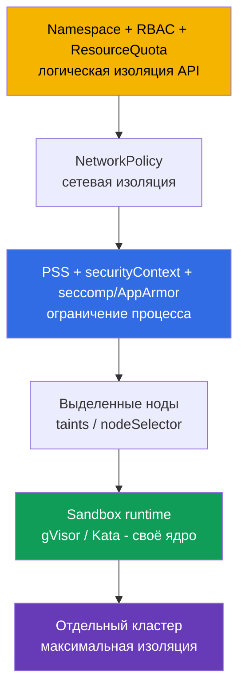
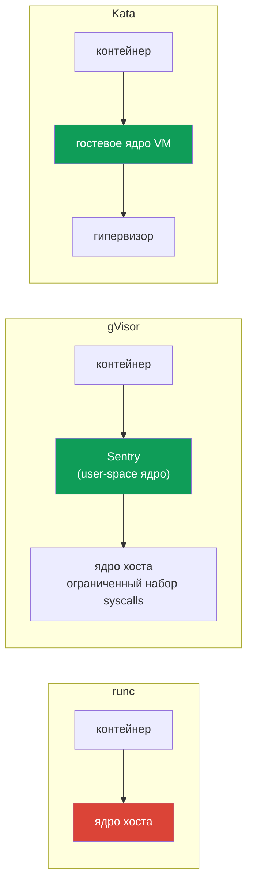

# Глава 15. Изоляция: multi-tenancy и sandbox-контейнеры

> **Что дальше.** Обычный контейнер - это процесс на общем ядре. Если в ядре есть
> уязвимость, никакой securityContext не спасёт: побег из контейнера = доступ к ноде и ко
> всем соседям. В этой главе разберём уровни изоляции в Kubernetes - от namespace до
> отдельного ядра - и научимся запускать поды в песочнице gVisor через RuntimeClass.

## 15.1. Уровни изоляции



Чем ниже уровень, тем сильнее изоляция и тем выше стоимость (ресурсы, производительность,
эксплуатация).

## 15.2. Multi-tenancy

Когда в одном кластере живут разные команды или клиенты, различают:

- **soft multi-tenancy** - арендаторы в целом доверенные (команды одной компании);
  достаточно namespace, RBAC, квот, NetworkPolicy, PSS;
- **hard multi-tenancy** - арендаторы недоверенные (внешние клиенты, запуск чужого кода);
  нужны sandbox-рантаймы, выделенные ноды или отдельные кластеры/виртуальные кластеры
  (vCluster).

Базовый набор для namespace-арендатора:

```bash
kubectl create ns tenant-a
kubectl label ns tenant-a pod-security.kubernetes.io/enforce=restricted
kubectl -n tenant-a create quota tenant-a --hard=cpu=4,memory=8Gi,pods=20
kubectl -n tenant-a create rolebinding tenant-a-admins --clusterrole=admin --group=tenant-a
# + default deny NetworkPolicy (глава 2) + LimitRange
```

Выделенные ноды для чувствительных или недоверенных workload'ов:

```bash
kubectl taint node node-2 tenant=untrusted:NoSchedule
kubectl label node node-2 tenant=untrusted
```

и в подах - `tolerations` + `nodeSelector`/`nodeAffinity`. Taint не пускает чужих, selector
не выпускает своих.

## 15.3. Почему общего ядра мало

У всех контейнеров ноды одно ядро. Эксплойт ядра (Dirty Pipe, Dirty COW и подобные) или
ошибка runtime (побег через runc, CVE-2019-5736, CVE-2024-21626) даёт выход на хост.
**Sandbox-рантаймы** ставят между контейнером и ядром хоста дополнительный барьер:

| Runtime | Как изолирует | Цена |
|---------|---------------|------|
| **gVisor** (`runsc`) | ядро в user space (Sentry) перехватывает системные вызовы | накладные расходы на syscalls и I/O, не все syscalls поддержаны |
| **Kata Containers** | лёгкая VM со своим ядром на каждый под | нужна виртуализация, больше памяти |



## 15.4. Установка gVisor в containerd

На ноде устанавливаем `runsc` и `containerd-shim-runsc-v1` (из репозитория gVisor), затем
регистрируем runtime в containerd.

containerd 1.x (`config.toml` version 2):

```toml
[plugins."io.containerd.grpc.v1.cri".containerd.runtimes.runsc]
  runtime_type = "io.containerd.runsc.v1"
```

containerd 2.x (`config.toml` version 3):

```toml
[plugins.'io.containerd.cri.v1.runtime'.containerd.runtimes.runsc]
  runtime_type = 'io.containerd.runsc.v1'
```

```bash
systemctl restart containerd
systemctl status containerd
```

Проверьте версию конфига (`head /etc/containerd/config.toml`) - путь секции зависит от неё.

## 15.5. RuntimeClass

`RuntimeClass` связывает имя, которое указывают в поде, с handler'ом в containerd:

```yaml
apiVersion: node.k8s.io/v1
kind: RuntimeClass
metadata:
  name: gvisor
handler: runsc                 # имя runtime из config.toml
scheduling:                    # опционально: куда планировать такие поды
  nodeSelector:
    RuntimeClass: runsc
```

Под:

```yaml
apiVersion: v1
kind: Pod
metadata:
  name: sandboxed
  namespace: team-purple
spec:
  runtimeClassName: gvisor
  containers:
  - name: nginx
    image: nginx:1.27
```

Для Deployment `runtimeClassName` ставится в `spec.template.spec`. Если на ноде нет
handler'а, под зависнет в `ContainerCreating` с ошибкой вида `no runtime for "runsc"`. Поле
`scheduling.nodeSelector` в RuntimeClass добавляется к nodeSelector пода автоматически - так
поды попадут только на ноды с gVisor.

## 15.6. Проверка, что под в песочнице

```bash
kubectl -n team-purple exec sandboxed -- dmesg
# [    0.000000] Starting gVisor...
kubectl -n team-purple exec sandboxed -- uname -r      # версия «ядра» gVisor, не хоста
crictl ps; crictl inspect <id> | grep -i runtimeType
```

`dmesg` в gVisor выдаёт характерные «шуточные» сообщения - это самый быстрый способ
убедиться в изоляции. Вывод часто требуется сохранить в файл на экзамене:

```bash
kubectl -n team-purple exec sandboxed -- dmesg > /var/work/tests/artifacts/gvisor-dmesg
```

## 15.7. Best practices

- **Изоляция пропорциональна недоверию**: свой код - namespace + PSS; чужой код - sandbox и
  выделенные ноды; разные клиенты с жёсткими требованиями - отдельные кластеры.
- **Выделенные ноды** для чувствительных workload'ов, чтобы компрометация соседа не давала
  доступ к их секретам и identity.
- **Sandbox для недоверенного кода** (CI-раннеры, пользовательские плагины, парсеры).
- **RuntimeClass с `scheduling`** - гарантирует, что поды попадут на ноды с рантаймом.
- **Своевременно обновляйте runc/containerd** - уязвимости рантайма ведут прямо на хост.

## 15.8. Итоги главы

- Уровни изоляции: namespace/RBAC → NetworkPolicy → PSS/securityContext → выделенные ноды →
  sandbox → отдельный кластер.
- Soft multi-tenancy - namespace-изоляция; hard - sandbox, ноды, кластеры.
- gVisor перехватывает syscalls в user-space ядре; Kata запускает под в микро-VM.
- Runtime регистрируется в `config.toml` containerd (путь зависит от версии конфига),
  связывается через `RuntimeClass.handler`, выбирается `runtimeClassName` в поде.
- Проверка - `dmesg` внутри пода.

## 15.9. Вопросы для самопроверки

1. Чем soft multi-tenancy отличается от hard?
2. Почему securityContext не защищает от эксплойта ядра?
3. Как gVisor и Kata по-разному изолируют контейнер?
4. Что связывает поле `handler` в RuntimeClass?
5. Что произойдёт с подом, если на ноде нет указанного runtime?
6. Как быстро убедиться, что под работает под gVisor?

## Практика

Установите gVisor, создайте RuntimeClass и переведите поды namespace на него:

🧪 Лаба 10: [tasks/cks/labs/10](../../labs/10/README.MD)

Задача **1 (Container Runtime Sandbox gVisor)**:

🧪 Мок 01: [tasks/cks/mock/01](../../mock/01/README.MD)

---
[Оглавление](../README_RU.md) · [Глава 14](../14/ru.md) · [Глава 16](../16/ru.md)
