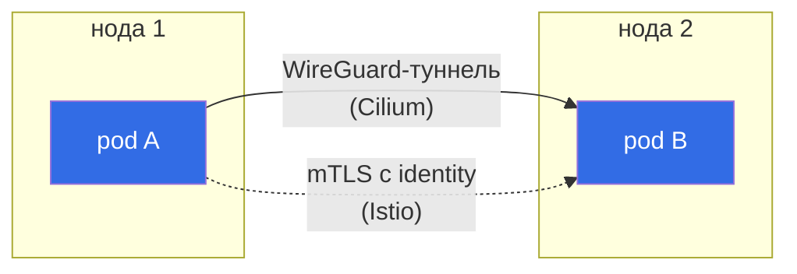

# Глава 16. Шифрование трафика pod-to-pod: Cilium и Istio

> **Что дальше.** Последняя тема домена Microservice Vulnerabilities. NetworkPolicy решает,
> **кто** может соединиться, но трафик внутри кластера по-прежнему идёт открытым текстом:
> скомпрометированная нода или сетевой компонент видят всё. В этой главе включим прозрачное
> шифрование между подами двумя способами: на уровне CNI (Cilium WireGuard/IPsec) и на уровне
> service mesh (Istio mTLS).

## 16.1. Два подхода

| | CNI-шифрование (Cilium WireGuard/IPsec) | Service mesh mTLS (Istio, Cilium mutual auth) |
|---|---|---|
| Уровень | L3, между нодами | L4/L7, между workload'ами |
| Что шифрует | весь трафик pod-to-pod между нодами | соединения между сервисами mesh |
| Identity | нет (ключи нод) | да (SPIFFE ID по ServiceAccount) |
| Авторизация по identity | нет | да (AuthorizationPolicy) |
| Изменения в подах | не нужны | sidecar или ambient/ztunnel |



Подходы не исключают друг друга: CNI-шифрование закрывает «всё и сразу», mesh даёт identity
и авторизацию.

## 16.2. Cilium + WireGuard

Cilium создаёт на каждой ноде интерфейс `cilium_wg0` и шифрует трафик между подами разных
нод. Установка через Helm или cilium CLI:

```bash
helm repo add cilium https://helm.cilium.io
helm install cilium cilium/cilium -n kube-system \
  --set encryption.enabled=true \
  --set encryption.type=wireguard
# или
cilium install --set encryption.enabled=true --set encryption.type=wireguard
```

Для уже установленного Cilium - `helm upgrade ... --reuse-values --set ...` и рестарт
агентов. Опционально `encryption.nodeEncryption=true` шифрует и трафик нод.

Проверка:

```bash
cilium status
cilium encryption status
# Encryption: Wireguard [NodeEncryption: Disabled, cilium_wg0 (Pubkey: ..., Port: 51871, Peers: 2)]

kubectl -n kube-system exec ds/cilium -- cilium-dbg status | grep Encryption
```

Для полной уверенности можно снять трафик на физическом интерфейсе ноды: пакеты между
подами должны идти по UDP 51871, а не как открытый HTTP.

```bash
tcpdump -ni eth0 udp port 51871
```

**IPsec** - альтернатива (`encryption.type=ipsec`), требует заранее создать Secret с ключом
`cilium-ipsec-keys`.

## 16.3. Cilium mutual authentication

Cilium умеет требовать взаимную аутентификацию workload'ов по SPIFFE identity (через SPIRE)
на уровне политики:

```bash
helm upgrade cilium cilium/cilium -n kube-system --reuse-values \
  --set authentication.mutual.spire.enabled=true \
  --set authentication.mutual.spire.install.enabled=true
```

```yaml
apiVersion: cilium.io/v2
kind: CiliumNetworkPolicy
metadata:
  name: backend-mutual-auth
  namespace: prod
spec:
  endpointSelector:
    matchLabels:
      app: backend
  ingress:
  - fromEndpoints:
    - matchLabels:
        app: frontend
    authentication:
      mode: required          # без взаимной аутентификации соединение не разрешено
```

## 16.4. Istio mTLS

В Istio каждый под с sidecar (или в ambient mode через ztunnel) получает сертификат со
SPIFFE ID `spiffe://cluster.local/ns/<ns>/sa/<sa>`. Режим задаётся `PeerAuthentication`:

| Режим | Что принимает под |
|-------|-------------------|
| `PERMISSIVE` (дефолт) | и mTLS, и plaintext |
| `STRICT` | только mTLS |
| `DISABLE` | только plaintext |

```yaml
apiVersion: security.istio.io/v1
kind: PeerAuthentication
metadata:
  name: default
  namespace: prod          # на namespace; в istio-system - на весь mesh
spec:
  mtls:
    mode: STRICT
```

Не забудьте включить инъекцию sidecar и пересоздать поды:

```bash
kubectl label ns prod istio-injection=enabled
kubectl -n prod rollout restart deploy
```

Проверка:

```bash
istioctl x describe pod <pod> -n prod
# клиент без sidecar из другого namespace должен получать ошибку соединения
kubectl run tmp -n default --rm -it --image=curlimages/curl -- curl -m 3 http://backend.prod:8080
```

Разрешения по identity дальше задаются `AuthorizationPolicy` (например, пускать к backend
только SA `frontend`). Подробно Istio разобран в курсе ICA этого репозитория.

## 16.5. Best practices

- **Шифруйте весь межнодовый трафик** (WireGuard в Cilium - минимальные усилия).
- **Для identity и авторизации - mesh** с `STRICT` mTLS на весь mesh, переход через
  `PERMISSIVE`.
- **Отдельный ServiceAccount на сервис** - SPIFFE identity строится из него.
- **Проверяйте, что шифрование реально работает** (`cilium encryption status`,
  `istioctl x describe`, tcpdump), а не только «включено в values».
- **mTLS не заменяет NetworkPolicy** и наоборот - defense-in-depth.

## 16.6. Итоги главы

- CNI-шифрование (WireGuard/IPsec) защищает весь межнодовый трафик без изменений в подах,
  но без identity.
- Mesh-mTLS даёт шифрование + identity (SPIFFE) + авторизацию по ней.
- Cilium: `encryption.enabled=true`, `encryption.type=wireguard`; проверка -
  `cilium encryption status`.
- Cilium mutual auth: SPIRE + `authentication.mode: required` в политике.
- Istio: `PeerAuthentication` `STRICT`, инъекция sidecar, проверка `istioctl x describe`.

## 16.7. Вопросы для самопроверки

1. Какую угрозу закрывает шифрование pod-to-pod, которую не закрывает NetworkPolicy?
2. Чем WireGuard в Cilium отличается от mTLS в Istio по возможностям?
3. Как проверить, что Cilium шифрует трафик?
4. Что означает режим `PERMISSIVE` и зачем он нужен?
5. Почему после включения инъекции sidecar нужно пересоздать поды?

## Практика

Установите Cilium с WireGuard:

🧪 Лаба 26: [tasks/cks/labs/26](../../labs/26/README.MD)

Политики Cilium с mutual authentication:

🧪 Лаба 27: [tasks/cks/labs/27](../../labs/27/README.MD)

Istio PeerAuthentication:

🧪 Лаба 30: [tasks/cks/labs/30](../../labs/30/README.MD)

---
[Оглавление](../README_RU.md) · [Глава 15](../15/ru.md) · [Глава 17](../17/ru.md)
