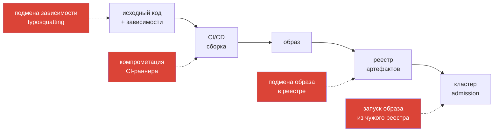

# Глава 18. Понимание supply chain: SBOM, CI/CD, реестры артефактов

> **Что дальше.** Прежде чем защищать цепочку поставки, нужно её увидеть: откуда берётся
> код, как он превращается в образ, где хранится и как попадает в кластер. И что именно
> внутри образа. В этой главе разберём этапы supply chain, типовые атаки на каждом из них и
> инструмент прозрачности - SBOM (Software Bill of Materials).

## 18.1. Цепочка поставки и атаки на неё



Известные примеры: SolarWinds (компрометация сборки), Codecov (подмена скрипта в CI),
event-stream и xz-utils (вредоносный код в зависимости). Вывод: доверять нельзя ни одному
звену «по умолчанию».

## 18.2. Фреймворки

- **SLSA** (Supply-chain Levels for Software Artifacts) - уровни зрелости сборки:
  документированный процесс → provenance → защищённая сборочная платформа.
- **Provenance / attestations** (in-toto) - подписанное утверждение, **как и из чего**
  собран артефакт.
- **Sigstore** (cosign, Fulcio, Rekor) - подпись и прозрачный журнал подписей (глава 19).

## 18.3. SBOM

**SBOM** - машиночитаемый список всех компонентов артефакта: пакеты ОС, библиотеки, их
версии, лицензии, хеши. Зачем:

- быстро ответить на вопрос «где у нас log4j 2.14?» при новом CVE;
- сканировать уязвимости по SBOM без повторного скачивания образа;
- проверять лицензии и выполнять требования регуляторов.

Два основных формата:

| Формат | Кто развивает | Где встречается |
|--------|---------------|-----------------|
| **SPDX** | Linux Foundation (ISO/IEC 5962) | Kubernetes публикует SBOM релизов в SPDX |
| **CycloneDX** | OWASP | популярен в AppSec-инструментах |

## 18.4. Генерация SBOM

**Trivy:**

```bash
trivy image --format spdx-json --output nginx.spdx.json nginx:1.27
trivy image --format cyclonedx --output nginx.cdx.json nginx:1.27
```

**Syft (Anchore):**

```bash
syft nginx:1.27 -o spdx-json > nginx.spdx.json
syft nginx:1.27 -o cyclonedx-json > nginx.cdx.json
```

**bom (kubernetes-sigs)** - инструмент, которым Kubernetes генерирует свои SBOM:

```bash
bom generate --image registry.k8s.io/kube-apiserver:v1.35.0 --format json --output apiserver.spdx.json
bom document outline apiserver.spdx.json     # древовидный обзор содержимого
```

## 18.5. Анализ SBOM

```bash
# сканирование уязвимостей по готовому SBOM
trivy sbom nginx.spdx.json
trivy sbom --severity CRITICAL nginx.cdx.json
grype sbom:./nginx.spdx.json

# найти конкретный пакет
jq -r '.packages[] | select(.name=="openssl") | .versionInfo' nginx.spdx.json
jq -r '.components[] | select(.name=="openssl") | .version' nginx.cdx.json
```

Типичная экзаменационная задача: «сгенерируйте SBOM образа в формате X и сохраните в файл»,
«найдите в SBOM версию пакета Y», «определите, какие образы из списка содержат уязвимый
пакет».

## 18.6. CI/CD как часть поверхности атаки

- **Секреты CI** (токены реестров, kubeconfig) - короткоживущие, через OIDC-федерацию, а не
  статические ключи.
- **Изоляция раннеров** - эфемерные раннеры, не общие между проектами; для недоверенных
  PR - без доступа к секретам.
- **Pinning зависимостей и actions** по хешу/digest, а не по плавающему тегу.
- **Сканирование в пайплайне**: SAST, сканирование зависимостей, образов (trivy), манифестов
  (kubesec, kube-linter), генерация SBOM и подпись образа.
- **Деплой только из пайплайна**: у людей нет прав на `kubectl apply` в продакшн (GitOps).

## 18.7. Реестры артефактов

- **Приватный реестр** (Harbor, ECR, GCR/Artifact Registry, ACR) с аутентификацией;
  `imagePullSecrets` или IAM нод для pull.
- **Прокси/зеркало** публичных реестров - контроль того, что приходит снаружи, и защита от
  исчезновения образов.
- **Immutable tags** - нельзя перезаписать `app:1.2.3` другим содержимым.
- **Сканирование в реестре** при push и регулярно.
- **Ссылка по digest** (`image@sha256:...`) в манифестах - однозначная идентификация
  содержимого.

## 18.8. Итоги главы

- Supply chain: код и зависимости → CI → образ → реестр → кластер; атаки возможны на каждом
  звене.
- SLSA, provenance/in-toto и sigstore - основа доверия к артефактам.
- SBOM - перечень компонентов; форматы SPDX и CycloneDX.
- Генерация: `trivy image --format spdx-json|cyclonedx`, `syft`, `bom generate`.
- Анализ: `trivy sbom`, `grype sbom:`, `jq`.
- CI/CD и реестры - часть поверхности атаки: короткие креды, pinning, immutable tags, digest.

## 18.9. Вопросы для самопроверки

1. Приведите пример атаки на каждое звено supply chain.
2. Чем SBOM полезен при появлении нового критического CVE?
3. Какие два формата SBOM наиболее распространены и кто их развивает?
4. Как сгенерировать SBOM образа в формате CycloneDX с помощью trivy?
5. Зачем указывать образ по digest, если тег уже есть?

## Практика

Отдельной лабы по SBOM пока нет. Самостоятельно на любой лабе с установленным trivy
(например, лаба 21):

1. Сгенерируйте SBOM образа `nginx:1.27` в SPDX JSON и CycloneDX.
2. Найдите в SBOM версию `openssl` и `libc`.
3. Просканируйте SBOM на CRITICAL-уязвимости через `trivy sbom`.

🧪 Кластер с trivy: [tasks/cks/labs/21](../../labs/21/README.MD)

---
[Оглавление](../README_RU.md) · [Глава 17](../17/ru.md) · [Глава 19](../19/ru.md)
