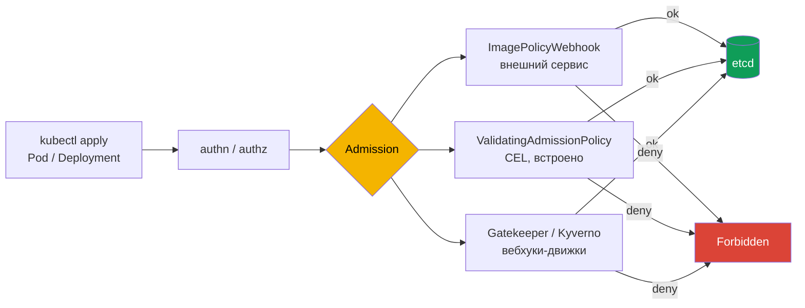

# Глава 19. Защита supply chain: разрешённые реестры, подпись и проверка артефактов

> **Что дальше.** Мы понимаем цепочку поставки; теперь поставим контроль на её последнем и
> самом важном звене - admission в кластере. Только образы из доверенных реестров, только
> закреплённые теги, только подписанные нами артефакты. В этой главе разберём все
> экзаменационные механизмы: ImagePolicyWebhook, OPA Gatekeeper, ValidatingAdmissionPolicy и
> подпись образов cosign.

## 19.1. Где ставить контроль



| Механизм | Где логика | Когда удобен |
|----------|------------|--------------|
| ImagePolicyWebhook | внешний HTTPS-сервис | централизованная проверка образов сторонним сервисом |
| ValidatingAdmissionPolicy | CEL-выражения в объекте кластера | простые правила без внешних компонентов (GA с 1.30) |
| OPA Gatekeeper | Rego в ConstraintTemplate | сложные политики, аудит существующих объектов |
| Kyverno | YAML-политики | валидация, мутация, проверка подписей образов |

## 19.2. ImagePolicyWebhook

Встроенный admission-плагин, который отправляет внешнему сервису объект `ImageReview` и
получает `allowed: true/false`. Нужны три файла.

**1. AdmissionConfiguration** (`/etc/kubernetes/pki/admission_config.yaml` или `.json`):

```yaml
apiVersion: apiserver.config.k8s.io/v1
kind: AdmissionConfiguration
plugins:
- name: ImagePolicyWebhook
  configuration:
    imagePolicy:
      kubeConfigFile: /etc/kubernetes/pki/webhook/admission_kube_config.yaml
      allowTTL: 50
      denyTTL: 50
      retryBackoff: 500
      defaultAllow: false        # если вебхук недоступен - ЗАПРЕТИТЬ (fail closed)
```

**2. kubeconfig вебхука** - «кластер» здесь это адрес сервиса проверки:

```yaml
apiVersion: v1
kind: Config
clusters:
- name: image-checker
  cluster:
    certificate-authority: /etc/kubernetes/pki/webhook/ca.crt
    server: https://image-bouncer-webhook:30020/image_policy
contexts:
- name: image-checker
  context:
    cluster: image-checker
    user: api-server
current-context: image-checker
users:
- name: api-server
  user:
    client-certificate: /etc/kubernetes/pki/webhook/apiserver-client.crt
    client-key: /etc/kubernetes/pki/webhook/apiserver-client.key
```

**3. Флаги kube-apiserver:**

```yaml
- --enable-admission-plugins=NodeRestriction,ImagePolicyWebhook
- --admission-control-config-file=/etc/kubernetes/pki/admission_config.yaml
```

Каталог `/etc/kubernetes/pki` у kubeadm уже примонтирован в под apiserver; если файлы
лежат в другом месте - добавьте volume и volumeMount. Имя хоста вебхука должно резолвиться
**с ноды** (часто через `/etc/hosts`).

Проверка:

```bash
kubectl run test-latest --image=nginx          # Forbidden: ... latest tag are not allowed
kubectl run test-tag --image=nginx:alpine3.17  # ok
```

`defaultAllow: false` - важный параметр безопасности: при недоступности вебхука поды не
создаются (fail closed). `true` - fail open, атакующий может «положить» вебхук и обойти
проверку.

## 19.3. ValidatingAdmissionPolicy (CEL)

Встроенный механизм без внешних компонентов. Разрешаем образы только из своего реестра:

```yaml
apiVersion: admissionregistration.k8s.io/v1
kind: ValidatingAdmissionPolicy
metadata:
  name: allowed-registries
spec:
  failurePolicy: Fail
  matchConstraints:
    resourceRules:
    - apiGroups: [""]
      apiVersions: ["v1"]
      operations: ["CREATE", "UPDATE"]
      resources: ["pods"]
  validations:
  - expression: >-
      object.spec.containers.all(c, c.image.startsWith('registry.example.com/')) &&
      (!has(object.spec.initContainers) ||
       object.spec.initContainers.all(c, c.image.startsWith('registry.example.com/')))
    message: "images must come from registry.example.com"
  - expression: "object.spec.containers.all(c, !c.image.endsWith(':latest') && c.image.contains(':'))"
    message: "image tag must be set and must not be latest"
---
apiVersion: admissionregistration.k8s.io/v1
kind: ValidatingAdmissionPolicyBinding
metadata:
  name: allowed-registries
spec:
  policyName: allowed-registries
  validationActions: [Deny]          # Deny | Warn | Audit
  matchResources:
    namespaceSelector:
      matchLabels:
        registry-policy: enforced
```

Без binding политика ничего не делает. Для постепенного внедрения - `validationActions:
[Warn, Audit]`.

## 19.4. OPA Gatekeeper

Gatekeeper - admission-вебхук с движком Open Policy Agent. Два объекта: **ConstraintTemplate**
(логика на Rego + схема параметров) и **Constraint** (применение с параметрами).

```yaml
apiVersion: templates.gatekeeper.sh/v1
kind: ConstraintTemplate
metadata:
  name: k8sblacklistregistries
spec:
  crd:
    spec:
      names:
        kind: K8sBlacklistRegistries
      validation:
        openAPIV3Schema:
          type: object
          properties:
            registries:
              type: array
              items:
                type: string
  targets:
  - target: admission.k8s.gatekeeper.sh
    rego: |
      package k8sblacklistregistries
      violation[{"msg": msg}] {
        container := input.review.object.spec.containers[_]
        registry := input.parameters.registries[_]
        startswith(container.image, registry)
        msg := sprintf("image %v from forbidden registry %v", [container.image, registry])
      }
---
apiVersion: constraints.gatekeeper.sh/v1beta1
kind: K8sBlacklistRegistries
metadata:
  name: no-very-bad-registry
spec:
  match:
    kinds:
    - apiGroups: [""]
      kinds: ["Pod"]
  parameters:
    registries: ["very-bad-registry.com"]
```

Полезные команды:

```bash
kubectl get constrainttemplates
kubectl get k8sblacklistregistries                 # у каждого kind - свой ресурс
kubectl describe k8sblacklistregistries no-very-bad-registry   # totalViolations - аудит существующих
kubectl run bad --image=very-bad-registry.com/nginx   # denied by no-very-bad-registry
```

Экзаменационная ловушка: часто уже есть шаблон «whitelist», и нужно поправить Rego или
параметры constraint. Читайте существующие объекты перед созданием новых.

## 19.5. Подпись и проверка образов: cosign

Разрешённый реестр не гарантирует, что образ собран вашим пайплайном. Это гарантирует
подпись.

```bash
cosign generate-key-pair                        # cosign.key / cosign.pub

# подписывать лучше digest, а не тег
cosign sign --key cosign.key registry.example.com/app@sha256:<digest>

cosign verify --key cosign.pub registry.example.com/app@sha256:<digest>

# keyless (sigstore): подпись по OIDC-идентичности CI, запись в Rekor
cosign verify registry.example.com/app@sha256:<digest> \
  --certificate-identity=https://github.com/org/repo/.github/workflows/build.yml@refs/heads/main \
  --certificate-oidc-issuer=https://token.actions.githubusercontent.com
```

Аналогично подписываются SBOM и provenance (`cosign attest`).

Проверку подписи **при деплое** выполняет admission-контроллер: Kyverno (`verifyImages`),
sigstore policy-controller, Connaisseur, Ratify + Gatekeeper. Пример Kyverno:

```yaml
apiVersion: kyverno.io/v1
kind: ClusterPolicy
metadata:
  name: verify-signature
spec:
  validationFailureAction: Enforce
  rules:
  - name: verify
    match:
      any:
      - resources:
          kinds: ["Pod"]
    verifyImages:
    - imageReferences: ["registry.example.com/*"]
      attestors:
      - entries:
        - keys:
            publicKeys: |-
              -----BEGIN PUBLIC KEY-----
              ...
              -----END PUBLIC KEY-----
```

## 19.6. Digest вместо тегов

Тег изменяем: `app:1.2.3` вчера и сегодня могут указывать на разные образы. Digest -
криптографический хеш содержимого.

```bash
crane digest nginx:1.27
skopeo inspect docker://nginx:1.27 | jq -r .Digest
# в манифесте:
# image: nginx@sha256:<digest>
```

## 19.7. Best practices

- **Allowlist реестров**, а не blacklist: неизвестное запрещено по умолчанию.
- **Запрет `latest` и образов без тега**, лучше - только digest.
- **Fail closed**: `defaultAllow: false`, `failurePolicy: Fail`, но с исключением системных
  namespace, чтобы не заблокировать восстановление кластера.
- **Подпись в CI, проверка в admission** - иначе подпись бесполезна.
- **Внедряйте через Warn/Audit** и смотрите нарушения до перехода в Deny/Enforce.

## 19.8. Итоги главы

- Контроль образов ставится на admission: ImagePolicyWebhook, VAP, Gatekeeper, Kyverno.
- ImagePolicyWebhook: AdmissionConfiguration + kubeconfig вебхука + флаги
  `--enable-admission-plugins` и `--admission-control-config-file`; `defaultAllow: false`.
- VAP: политика с CEL + обязательный binding с `validationActions`.
- Gatekeeper: ConstraintTemplate (Rego) + Constraint (параметры); `describe` показывает
  нарушения.
- cosign: `sign`/`verify` по ключу или keyless; проверка при деплое - Kyverno/policy-controller.
- Digest однозначно идентифицирует образ, тег - нет.

## 19.9. Вопросы для самопроверки

1. Какие три файла/настройки нужны для ImagePolicyWebhook?
2. Чем опасен `defaultAllow: true`?
3. Почему ValidatingAdmissionPolicy без binding ничего не делает?
4. Чем ConstraintTemplate отличается от Constraint?
5. Почему подписывать нужно digest, а не тег?
6. Где в кластере проверяется подпись образа?

## Практика

Запретите образы из `very-bad-registry.com` через OPA Gatekeeper:

🧪 Лаба 07: [tasks/cks/labs/07](../../labs/07/README.MD)

Настройте ImagePolicyWebhook:

🧪 Лаба 25: [tasks/cks/labs/25](../../labs/25/README.MD)

Задачи **13 (Image policy webhook)** и **17 (OPA)**:

🧪 Мок 01: [tasks/cks/mock/01](../../mock/01/README.MD)

---
[Оглавление](../README_RU.md) · [Глава 18](../18/ru.md) · [Глава 20](../20/ru.md)
