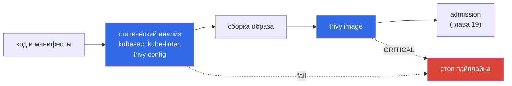

# Глава 20. Статический анализ манифестов и образов

> **Что дальше.** Завершаем Supply Chain Security. Лучшее время найти `privileged: true` или
> критический CVE - до того, как объект попал в кластер. В этой главе разберём инструменты
> статического анализа: kubesec и KubeLinter для манифестов, Trivy для образов и
> конфигураций - и то, как быстро использовать их на экзамене.

## 20.1. Что и чем проверяем

| Что | Инструмент | Что находит |
|-----|-----------|-------------|
| Манифесты Kubernetes | **kubesec** | рисковые настройки, числовой score |
| Манифесты, Helm-чарты | **KubeLinter** | нарушения best practices и безопасности |
| Образы | **Trivy** (`image`) | CVE в пакетах ОС и библиотеках, секреты |
| Конфиги (YAML, Dockerfile, Terraform) | **Trivy** (`config`) | misconfigurations |
| Живой кластер | **Trivy** (`k8s`), kube-bench | уязвимости и misconfig в запущенном |



## 20.2. kubesec

kubesec оценивает Pod/Deployment/StatefulSet и выдаёт **score**: положительные баллы за
хорошие практики (`runAsNonRoot`, `readOnlyRootFilesystem`, лимиты), отрицательные и
**critical** - за опасные (`privileged`, `hostNetwork`, `SYS_ADMIN`).

```bash
kubesec scan pod.yaml
# или через docker/podman, если бинарника нет
podman run -i kubesec/kubesec:v2 scan /dev/stdin < pod.yaml
```

Фрагмент вывода:

```json
[{
  "object": "Pod/web.default",
  "valid": true,
  "score": -30,
  "scoring": {
    "critical": [{ "id": "Privileged", "selector": "containers[] .securityContext .privileged == true", "points": -30 }],
    "advise": [{ "id": "ReadOnlyRootFilesystem", "points": 1 }, { "id": "RunAsNonRoot", "points": 1 }]
  }
}]
```

Экзаменационная задача: «исправьте манифест так, чтобы kubesec выдавал score не меньше N /
без critical». Идём по `critical`, затем по `advise`, добавляя поля securityContext и
ресурсы, и перезапускаем скан.

## 20.3. KubeLinter

```bash
kube-linter lint deploy.yaml
kube-linter lint ./manifests/
kube-linter lint ./chart/                  # Helm-чарт целиком
kube-linter checks list                    # все доступные проверки
```

Пример вывода:

```
deploy.yaml: (object: default/web apps/v1, Kind=Deployment) container "web" does not have a
read-only root file system (check: no-read-only-root-fs, remediation: Set readOnlyRootFilesystem to true ...)
deploy.yaml: (object: ...) container "web" is not set to runAsNonRoot (check: run-as-non-root ...)
```

Проверки можно включать/выключать конфигом `.kube-linter.yaml` или аннотацией на объекте
`ignore-check.kube-linter.io/<check>: "причина"`.

## 20.4. Trivy: образы

```bash
trivy image nginx:1.27
trivy image --severity HIGH,CRITICAL nginx:1.27
trivy image --ignore-unfixed --severity CRITICAL nginx:1.27   # только то, что можно исправить
trivy image --scanners vuln,secret app:1.0
trivy image -f json -o report.json nginx:1.27
trivy image --exit-code 1 --severity CRITICAL app:1.0         # для CI: падение при находках

# проверить, есть ли конкретный CVE в образе
trivy image nginx:1.16.1-alpine | grep -E 'CVE-2020-10878|CVE-2020-1967'
```

Типичная задача: «из списка образов, используемых подами namespace, найдите те, что содержат
CVE X, и удалите/масштабируйте в 0 соответствующие workload'ы». Сначала собираем образы:

```bash
kubectl -n team get pods -o jsonpath='{range .items[*]}{.metadata.name}{"\t"}{.spec.containers[*].image}{"\n"}{end}'
for img in $(kubectl -n team get pods -o jsonpath='{.items[*].spec.containers[*].image}' | tr ' ' '\n' | sort -u); do
  echo "== $img"; trivy image -q --severity CRITICAL "$img" | grep -c CVE-2020-1967
done
```

## 20.5. Trivy: конфигурации и кластер

```bash
trivy config deploy.yaml          # misconfig в манифестах
trivy config Dockerfile           # USER root, latest, ADD вместо COPY и т.п.
trivy config ./manifests/

trivy k8s --report summary cluster          # сканирование живого кластера
```

## 20.6. Итоги главы

- Статический анализ ловит проблемы до деплоя: манифесты, Dockerfile, образы.
- kubesec: score, `critical` и `advise`; исправляем по списку и пересканируем.
- KubeLinter: проверки best practices, `checks list`, игнор через аннотацию.
- Trivy: `image` (CVE и секреты), `config` (misconfig), `sbom`, `k8s`; фильтр
  `--severity`, `--ignore-unfixed`, `--exit-code` для CI.
- Анализ встраивают в CI и дублируют контролем на admission (глава 19).

## 20.7. Вопросы для самопроверки

1. Что означает отрицательный score и секция `critical` у kubesec?
2. Как запустить kubesec, если бинарника нет, но есть podman?
3. Как игнорировать конкретную проверку KubeLinter для одного объекта?
4. Какой флаг trivy оставит только уязвимости, для которых есть исправление?
5. Как проверить все образы подов namespace на конкретный CVE?

## Практика

Найдите образы с заданными CVE через trivy:

🧪 Лаба 21: [tasks/cks/labs/21](../../labs/21/README.MD)

Задачи **2 (Image Vulnerability Scanning)**:

🧪 Мок 01: [tasks/cks/mock/01](../../mock/01/README.MD)

Самостоятельно: возьмите небезопасный Deployment (privileged, root, без лимитов), доведите
kubesec score до положительного без `critical` и уберите все предупреждения kube-linter.

---
[Оглавление](../README_RU.md) · [Глава 19](../19/ru.md) · [Глава 21](../21/ru.md)
