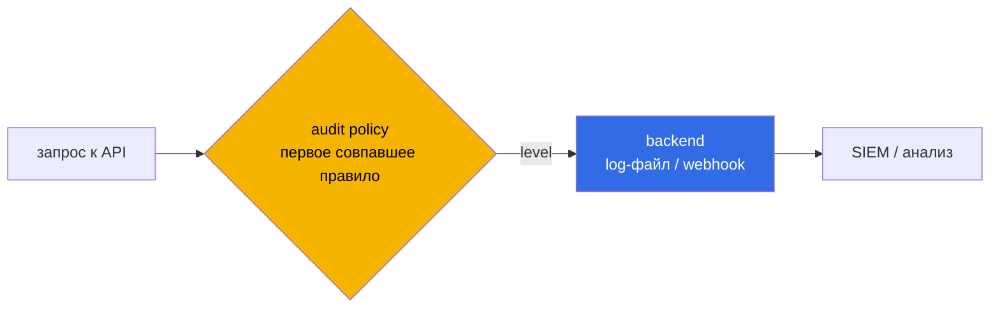

# Глава 21. Аудит-логи Kubernetes

> **Что дальше.** Открываем домен **Monitoring, Logging and Runtime Security (20%)**. Без
> аудита вы не узнаете, кто прочитал секрет, кто создал privileged-под и откуда пришёл
> подозрительный запрос. Аудит-лог API-сервера - основной источник для расследования
> действий в control plane. В этой главе включим его и научимся писать политики, которые
> пишут нужное и не пишут лишнее.

## 21.1. Как устроен аудит

Каждый запрос к API проходит **стадии**, и на каждой может быть сгенерировано событие:

| Стадия | Когда |
|--------|-------|
| `RequestReceived` | запрос получен, до обработки |
| `ResponseStarted` | начата отправка ответа (для долгих запросов, например watch) |
| `ResponseComplete` | ответ отправлен |
| `Panic` | внутренняя ошибка |

Что писать - определяют **уровни**:

| Уровень | Что пишется |
|---------|-------------|
| `None` | ничего |
| `Metadata` | кто, что, когда, над каким ресурсом, код ответа - **без тел** |
| `Request` | метаданные + тело запроса |
| `RequestResponse` | метаданные + тела запроса и ответа |



## 21.2. Политика аудита

Правила проверяются **сверху вниз, срабатывает первое совпадение**. Поэтому частные правила -
вверху, общее правило «всё остальное» - внизу.

```yaml
# /etc/kubernetes/policy/log-policy.yaml
apiVersion: audit.k8s.io/v1
kind: Policy
omitStages:
- RequestReceived                  # не дублировать события
rules:
# секреты - только метаданные (никогда не пишем значения в лог!)
- level: Metadata
  resources:
  - group: ""
    resources: ["secrets"]
  namespaces: ["prod"]

# configmaps в billing - полностью
- level: RequestResponse
  resources:
  - group: ""
    resources: ["configmaps"]
  namespaces: ["billing"]

# изменения деплойментов - с телом запроса
- level: Request
  resources:
  - group: "apps"
    resources: ["deployments"]
  verbs: ["create", "update", "patch", "delete"]

# шумные системные запросы - не пишем
- level: None
  users: ["system:kube-proxy"]
  verbs: ["watch"]
- level: None
  nonResourceURLs: ["/healthz*", "/livez*", "/readyz*", "/version"]

# всё остальное - метаданные
- level: Metadata
```

Поля правила: `level`, `users`, `userGroups`, `verbs`, `resources` (`group`, `resources`,
`resourceNames`), `namespaces`, `nonResourceURLs`, `omitStages`. Для core-группы `group: ""`.
Подресурсы указываются как `pods/exec`, `pods/log`.

Важно: `RequestResponse` для secrets записал бы значения секретов в лог - это утечка.
Для secrets максимум `Metadata`.

## 21.3. Включение в kube-apiserver

```yaml
spec:
  containers:
  - command:
    - kube-apiserver
    - --audit-policy-file=/etc/kubernetes/policy/log-policy.yaml
    - --audit-log-path=/var/log/kubernetes/audit/audit.log
    - --audit-log-maxage=7          # дней хранить
    - --audit-log-maxbackup=2       # файлов ротации
    - --audit-log-maxsize=50        # МБ на файл
    volumeMounts:
    - name: audit-policy
      mountPath: /etc/kubernetes/policy/log-policy.yaml
      readOnly: true
    - name: audit-log
      mountPath: /var/log/kubernetes/audit/
  volumes:
  - name: audit-policy
    hostPath:
      path: /etc/kubernetes/policy/log-policy.yaml
      type: File
  - name: audit-log
    hostPath:
      path: /var/log/kubernetes/audit/
      type: DirectoryOrCreate
```

Путь к логу может быть и файлом в каталоге, который уже смонтирован; главное - чтобы
**и политика, и каталог логов** были видны контейнеру. Самая частая ошибка - забытый volume.

После изменения **только политики** (без изменения флагов) apiserver её не перечитает:
нужно перезапустить под, например временно переместив манифест из `manifests/` и вернув
обратно.

Альтернативный backend - webhook (`--audit-webhook-config-file`) для отправки событий во
внешнюю систему.

## 21.4. Анализ лога

Каждая строка - JSON-событие:

```json
{"kind":"Event","level":"Metadata","stage":"ResponseComplete",
 "verb":"get","user":{"username":"system:serviceaccount:dev:ci"},
 "sourceIPs":["10.0.1.15"],"objectRef":{"resource":"secrets","namespace":"prod","name":"db"},
 "responseStatus":{"code":200},"requestReceivedTimestamp":"2026-09-25T10:15:03.123Z"}
```

```bash
LOG=/var/log/kubernetes/audit/audit.log

# кто читал секреты
jq -c 'select(.objectRef.resource=="secrets" and .verb=="get") | [.user.username,.objectRef.namespace,.objectRef.name]' $LOG

# кто делал exec в поды
jq -c 'select(.objectRef.subresource=="exec") | [.requestReceivedTimestamp,.user.username,.objectRef.namespace,.objectRef.name]' $LOG

# все действия конкретного SA
jq -c 'select(.user.username=="system:serviceaccount:dev:ci") | [.verb,.objectRef.resource,.objectRef.name]' $LOG

# отказы авторизации
jq -c 'select(.responseStatus.code==403)' $LOG | tail
```

## 21.5. Best practices

- **Аудит включён всегда** и лог уходит во внешнее хранилище/SIEM (атакующий с root на
  control plane может его стереть).
- **Secrets, tokens - только `Metadata`**.
- **Подробно** - изменения RBAC, exec/attach, создание подов в чувствительных namespace.
- **Не пишите шум** (health, watch системных компонентов) - иначе важное утонет.
- **Ротация** через `maxage/maxbackup/maxsize`.

## 21.6. Итоги главы

- Стадии: RequestReceived, ResponseStarted, ResponseComplete, Panic; уровни: None, Metadata,
  Request, RequestResponse.
- Политика: первое совпавшее правило; частное - вверху, общее - внизу; `omitStages`.
- Флаги: `--audit-policy-file`, `--audit-log-path`, `--audit-log-maxage/maxbackup/maxsize`
  + volumes для политики и каталога логов.
- Secrets - максимум `Metadata`.
- Анализ - `jq` по `user.username`, `objectRef`, `verb`, `responseStatus.code`.

## 21.7. Вопросы для самопроверки

1. Почему правило «всё остальное» должно быть последним?
2. Чем уровень `Request` отличается от `RequestResponse`?
3. Почему для secrets нельзя ставить `RequestResponse`?
4. Какие volumes нужно добавить в манифест apiserver для аудита?
5. Как найти в логе всех, кто делал `exec` в поды?
6. Почему после правки только файла политики изменения не применяются?

## Практика

Включите аудит с заданной политикой:

🧪 Лаба 17: [tasks/cks/labs/17](../../labs/17/README.MD)

Задача **3 (Enable audit log)**:

🧪 Мок 01: [tasks/cks/mock/01](../../mock/01/README.MD)

---
[Оглавление](../README_RU.md) · [Глава 20](../20/ru.md) · [Глава 22](../22/ru.md)
