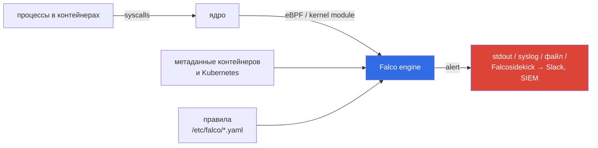
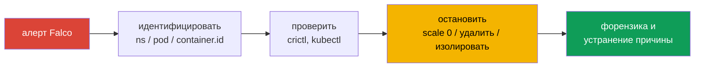

# Глава 22. Поведенческий анализ в рантайме: Falco

> **Что дальше.** Аудит видит запросы к API, но не видит, что происходит **внутри**
> контейнера: запущенный shell, чтение `/etc/shadow`, запись в `/usr/bin`, неожиданное
> исходящее соединение. Это видит runtime-детект на уровне системных вызовов. Стандарт де-факто
> в Kubernetes - **Falco** (проект CNCF). В этой главе научимся читать его алерты, писать и
> переопределять правила и по ним находить и останавливать вредоносный под.

## 22.1. Как работает Falco



Falco получает системные вызовы через драйвер (современный вариант - `modern_ebpf`),
обогащает их метаданными (контейнер, образ, под, namespace) и проверяет правилами. Falco -
**детект**, а не блокировка: он сообщает, реагируете вы (или автоматизация).

## 22.2. Где что лежит

| Что | Где |
|-----|-----|
| Главный конфиг | `/etc/falco/falco.yaml` |
| Встроенные правила | `/etc/falco/falco_rules.yaml` (не редактируйте - перезапишется при обновлении) |
| Ваши правила/переопределения | `/etc/falco/falco_rules.local.yaml`, `/etc/falco/rules.d/` |
| Сервис | `falco-modern-bpf.service` (или `falco-kmod`, `falco-bpf`, `falco`) |
| Алерты | `journalctl -u falco-modern-bpf`, syslog или `file_output` |

```bash
systemctl list-units | grep falco
journalctl -fu falco-modern-bpf
grep -A3 file_output /etc/falco/falco.yaml
```

Если Falco развёрнут в кластере (Helm), алерты - в логах DaemonSet:
`kubectl -n falco logs ds/falco -f`.

## 22.3. Структура правила

```yaml
- rule: Read sensitive file in container
  desc: Detect reading of /etc/shadow inside a container
  condition: >
    open_read and container and fd.name = /etc/shadow
  output: >
    Sensitive file opened (file=%fd.name proc=%proc.name cmd=%proc.cmdline
    user=%user.name container=%container.name image=%container.image.repository
    ns=%k8s.ns.name pod=%k8s.pod.name)
  priority: WARNING
  tags: [filesystem, cks]
```

Элементы:

- **`condition`** - фильтр на языке Falco: поля событий (`evt.type`, `proc.name`,
  `fd.name`, `container.id`, `k8s.ns.name`...), операторы `=`, `in`, `contains`,
  `startswith`, `and/or/not`;
- **macros** - переиспользуемые куски условий (`spawned_process`, `open_read`, `open_write`,
  `container`);
- **lists** - списки значений (`shell_binaries`, `sensitive_file_names`);
- **`output`** - текст алерта с полями через `%`;
- **`priority`** - `EMERGENCY` ... `DEBUG`.

Полезные поля для вывода:

| Поле | Что это |
|------|---------|
| `%evt.time` | время события с наносекундами |
| `%container.id`, `%container.name` | контейнер |
| `%container.image.repository` | образ |
| `%user.name`, `%user.uid` | пользователь процесса |
| `%proc.name`, `%proc.cmdline`, `%proc.pname` | процесс, командная строка, родитель |
| `%k8s.ns.name`, `%k8s.pod.name` | namespace и под |
| `%fd.name` | файл или сокет |

Полный список: `falco --list`.

## 22.4. Изменение встроенного правила

Типичная задача: «измените формат вывода правила X» или «поменяйте priority». Встроенный файл
не трогаем - переопределяем в `falco_rules.local.yaml`, который загружается **после**:

```yaml
# /etc/falco/falco_rules.local.yaml
- rule: Terminal shell in container
  override:
    output: replace
    priority: replace
  output: >
    %evt.time,%container.id,%container.name,%user.name,%k8s.ns.name,%k8s.pod.name
  priority: CRITICAL
```

Добавить условие к существующему правилу (например, исключение):

```yaml
- rule: Terminal shell in container
  condition: and not k8s.ns.name = debug-tools
  override:
    condition: append
```

Второй вариант - скопировать правило целиком в local-файл с тем же именем и отредактировать.

Применение и проверка синтаксиса:

```bash
falco --dry-run      # или: falco -r /etc/falco/falco_rules.yaml -r /etc/falco/falco_rules.local.yaml --dry-run
systemctl restart falco-modern-bpf
```

## 22.5. Своё правило: доступ к памяти

Обнаружим попытку чтения памяти хоста/процессов из контейнера:

```yaml
- rule: Unauthorized memory access
  desc: Container reads /dev/mem, /dev/kmem, /proc/kcore or another process memory
  condition: >
    open_read and container and
    (fd.name in (/dev/mem, /dev/kmem, /proc/kcore) or fd.name glob "/proc/*/mem")
  output: >
    Memory access (file=%fd.name proc=%proc.cmdline user=%user.name
    container=%container.name ns=%k8s.ns.name pod=%k8s.pod.name)
  priority: CRITICAL
```

## 22.6. Разовый запуск и сбор лога

Если задача требует «соберите события за N секунд в файл в заданном формате»:

```bash
# остановить сервис, чтобы не было двух инстансов, и запустить вручную
systemctl stop falco-modern-bpf
timeout 60 falco -r /etc/falco/falco_rules.yaml -r /etc/falco/falco_rules.local.yaml \
  | tee /tmp/falco.log
systemctl start falco-modern-bpf

# оставить только события нужного образа
grep nginx /tmp/falco.log > /var/work/tests/artifacts/12/log
```

Альтернатива - `sysdig` с фильтром и форматом:

```bash
sysdig -M 30 -p "%evt.time,%container.id,%container.name,%user.name,%k8s.ns.name,%k8s.pod.name" \
  container.image.repository=nginx
```

## 22.7. От алерта к действию



```bash
# по container.id из алерта найти под
crictl ps --id <container-id>
crictl inspect <container-id> | jq -r '.status.labels["io.kubernetes.pod.namespace"], .status.labels["io.kubernetes.pod.name"]'

# остановить: масштабировать владельца в 0 (под не пересоздастся)
kubectl -n <ns> get pod <pod> -o jsonpath='{.metadata.ownerReferences[0].kind}/{.metadata.ownerReferences[0].name}'
kubectl -n <ns> scale deploy <name> --replicas=0
```

Для форензики иногда лучше **изолировать** под (NetworkPolicy deny all по его меткам,
удалить метку из селектора Service), а не удалять сразу - подробнее в главе 23.

## 22.8. Best practices

- **Встроенные правила - не редактировать**, изменения - в `falco_rules.local.yaml` или
  `rules.d/`.
- **Настройте доставку алертов** (Falcosidekick → SIEM/чат) - алерт в journald никто не
  увидит.
- **Тюнинг**: исключения для легитимного поведения, иначе важное утонет в шуме.
- **Проверка синтаксиса** перед рестартом (`--dry-run`) - иначе Falco не стартует и вы
  без детекта.
- **Falco + immutable-контейнеры** (глава 24): если контейнер не должен ничего писать и
  запускать, любое отклонение - сигнал.

## 22.9. Итоги главы

- Falco анализирует системные вызовы (eBPF) и метаданные K8s по правилам; это детект, не
  блокировка.
- Правила: `rule`, `condition`, `output`, `priority`; макросы и списки.
- Встроенные правила - `falco_rules.yaml`, свои - `falco_rules.local.yaml` (грузится после).
- Переопределение: `override` с `replace`/`append` или копия правила с тем же именем.
- Поля вывода: `%evt.time`, `%container.id`, `%container.name`, `%user.name`,
  `%k8s.ns.name`, `%k8s.pod.name`.
- От алерта: container.id → под → владелец → scale 0 / изоляция.

## 22.10. Вопросы для самопроверки

1. Почему Falco называют детектом, а не защитой?
2. В каком файле менять правила и почему не в `falco_rules.yaml`?
3. Как заменить output встроенного правила, не копируя его целиком?
4. Как по `container.id` из алерта найти под и его namespace?
5. Почему для остановки вредоносного пода лучше масштабировать Deployment в 0, а не удалить под?

## Практика

Соберите лог событий пода в заданном формате с Falco/sysdig:

🧪 Лаба 02: [tasks/cks/labs/02](../../labs/02/README.MD)

Обнаружьте и остановите несанкционированный доступ к памяти:

🧪 Лаба 28: [tasks/cks/labs/28](../../labs/28/README.MD)

Задача **12 (Falco)**:

🧪 Мок 02: [tasks/cks/mock/02](../../mock/02/README.MD)

---
[Оглавление](../README_RU.md) · [Глава 21](../21/ru.md) · [Глава 23](../23/ru.md)
