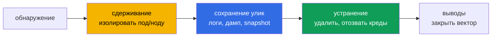

# Глава 23. Обнаружение угроз и расследование атак

> **Что дальше.** Алерт получен - что дальше? В программе CKS два пункта про это: «обнаружение
> угроз в инфраструктуре, приложениях, сети, данных, у пользователей и workload'ов» и
> «расследование фаз атаки и поиск злоумышленника». В этой главе соберём всё вместе: какие
> сигналы на каком уровне смотреть, как по фазам атаки восстановить картину и какими
> командами на ноде найти вредоносный процесс.

## 23.1. Источники сигналов

| Уровень | Что может произойти | Где смотреть |
|---------|---------------------|--------------|
| Инфраструктура (ноды) | новые процессы на хосте, изменение бинарников, новые пользователи | Falco, auditd, `/var/log/auth.log`, `journalctl` |
| Control plane / пользователи | чтение secrets, изменения RBAC, exec в поды, анонимные запросы | аудит-лог API (глава 21) |
| Workload'ы | shell в контейнере, запись в rootfs, запуск бинарников из `/tmp` | Falco (глава 22), `crictl`, `/proc` |
| Сеть | исходящие соединения на неизвестные адреса, сканирование, майнинг-пулы | Falco, NetworkPolicy-логи CNI (Hubble для Cilium), flow logs |
| Данные | массовое чтение secrets/configmaps, выгрузка БД | аудит-лог, логи приложения |
| Приложения | ошибки аутентификации, аномальные запросы | логи приложения, ingress/mesh access logs |

Ни один источник не видит всё: аудит не видит внутренности контейнера, Falco не видит запросы
к API через корректные креды. Нужна корреляция.

## 23.2. Фазы атаки

Используем матрицу **MITRE ATT&CK for Containers** / **Kubernetes Threat Matrix**, чтобы
разложить наблюдаемое по фазам:

```mermaid
flowchart LR
    IA["Initial Access<br>RCE в приложении"] --> EX["Execution<br>shell, curl | sh"]
    EX --> PE["Persistence<br>cronjob, DaemonSet,<br>SSH-ключ на ноде"]
    PE --> PR["Privilege Escalation<br>privileged pod, hostPath"]
    PR --> DE["Defense Evasion<br>удаление логов,<br>имя как у системного пода"]
    DE --> CA["Credential Access<br>SA-токены, secrets,<br>metadata"]
    CA --> DI["Discovery<br>kubectl auth can-i,<br>сканирование сети"]
    DI --> LM["Lateral Movement<br>другие поды, облако"]
    LM --> IM["Impact<br>майнинг, кража, DoS"]
    style IA fill:#db4437,color:#fff
    style IM fill:#db4437,color:#fff
```



Типичные признаки по фазам:

| Фаза | Признаки |
|------|----------|
| Execution | `sh`/`bash` в контейнере без TTY от приложения, `curl`/`wget` к внешним IP |
| Persistence | новые CronJob/DaemonSet, поды в `kube-system` с необычными именами, изменения в `/etc/cron*` на ноде |
| Privilege Escalation | создание privileged-подов, hostPath `/`, `nsenter`, setuid-бинарники |
| Defense Evasion | удаление/обнуление логов, `history -c`, отключение Falco/аудита |
| Credential Access | чтение `/var/run/secrets/.../token`, `get secrets` от необычного субъекта, запросы к 169.254.169.254 |
| Discovery | `kubectl auth can-i --list`, обращения к `kubernetes.default`, сканирование портов |
| Impact | высокая CPU (майнер), соединения на порты пулов (3333, 4444, 14444) |

## 23.3. Расследование на ноде

Найти процесс и его контейнер:

```bash
# процессы с высокой нагрузкой / подозрительные имена
ps -ef --forest | less
top -b -n1 | head -20

# какой контейнер у процесса
cat /proc/<pid>/cgroup                       # содержит id контейнера
crictl ps -a | grep <container-id-prefix>
crictl inspect <id> | jq -r '.info.pid, .status.labels'
```

Что делает процесс:

```bash
ls -l /proc/<pid>/exe                        # реальный бинарник (даже если файл удалён - "(deleted)")
cat /proc/<pid>/cmdline | tr '\0' ' '
cat /proc/<pid>/environ | tr '\0' '\n'       # переменные окружения
ls -l /proc/<pid>/fd                         # открытые файлы и сокеты
ls -l /proc/<pid>/cwd

ss -tpn | grep "pid=<pid>"                   # сетевые соединения процесса
lsof -p <pid>
strace -f -p <pid> -e trace=network,file     # что делает прямо сейчас
```

Найти бинарник в файловой системе контейнера:

```bash
crictl inspect <id> | jq -r '.info.runtimeSpec.root.path'     # rootfs
find /proc/<pid>/root/tmp /proc/<pid>/root/dev/shm -type f -newer /proc/<pid>/root/etc/hostname
```

Сравнить контейнер с образом: `crictl exec <id> ls -la /usr/bin` против эталона, или
`podman diff` для локальных контейнеров.

## 23.4. Расследование в кластере

```bash
# что недавно создавалось
kubectl get pods -A --sort-by=.metadata.creationTimestamp | tail
kubectl get cronjobs,daemonsets -A
kubectl get events -A --sort-by=.lastTimestamp | tail -30

# поды с опасными настройками
kubectl get pods -A -o json | jq -r '.items[] | select(.spec.hostPID==true or .spec.hostNetwork==true or ([.spec.containers[].securityContext.privileged]|any)) | "\(.metadata.namespace)/\(.metadata.name)"'

# кто это создал - в аудит-логе
jq -c 'select(.verb=="create" and .objectRef.resource=="pods" and .objectRef.name=="<pod>") | .user' /var/log/kubernetes/audit/audit.log
```

## 23.5. Реагирование: сдержать, сохранить, устранить



- **Сдерживание**: NetworkPolicy deny-all на метки пода, убрать под из Service (снять метку),
  `kubectl cordon` ноды, масштабировать владельца в 0.
- **Сохранение улик**: `kubectl logs`, `crictl inspect`, копия rootfs/`/proc/<pid>`, при
  возможности - `crictl checkpoint` или snapshot диска ноды. Удалённый под - потерянные
  улики.
- **Устранение**: удалить вредоносные объекты (включая persistence: CronJob, DaemonSet,
  webhook'и, RBAC-привязки), **отозвать креды** (перевыпустить токены SA - удалить/пересоздать
  SA или поды, ротировать секреты и облачные ключи), пересоздать скомпрометированную ноду.
- **Выводы**: закрыть вектор входа (PSS, NetworkPolicy, патч образа).

На экзамене обычно требуется только сдерживание: найти под по признакам (процесс, файл,
соединение) и масштабировать его Deployment в 0 или удалить.

## 23.6. Итоги главы

- Сигналы на разных уровнях: ноды, control plane, workload'ы, сеть, данные, приложения;
  нужна корреляция источников.
- Фазы атаки по MITRE ATT&CK for Containers помогают восстановить картину.
- На ноде: `ps`, `/proc/<pid>/{exe,cmdline,environ,fd,root}`, `ss -tpn`, `lsof`, `strace`,
  `crictl inspect`.
- В кластере: свежие объекты, опасные поды, события, аудит-лог для поиска автора.
- Реагирование: сдержать → сохранить улики → устранить (включая persistence и креды) →
  выводы.

## 23.7. Вопросы для самопроверки

1. Какие угрозы видит аудит-лог и не видит Falco, и наоборот?
2. Какие признаки характерны для фазы Persistence в Kubernetes?
3. Как по PID процесса на ноде найти под и namespace?
4. Как узнать реальный бинарник процесса, если файл уже удалён?
5. Почему удаление пода сразу после обнаружения - не всегда лучший первый шаг?
6. Какие креды нужно отозвать после компрометации пода?

## Практика

Найдите и остановите процесс, читающий память:

🧪 Лаба 28: [tasks/cks/labs/28](../../labs/28/README.MD)

Самостоятельно: запустите в namespace `test` под, который в цикле делает `cat /etc/shadow`
и `wget` на внешний адрес. Найдите его тремя способами - через Falco, через `ps`/`/proc` на
ноде и через `ss -tpn` - и изолируйте NetworkPolicy, не удаляя.

---
[Оглавление](../README_RU.md) · [Глава 22](../22/ru.md) · [Глава 24](../24/ru.md)
