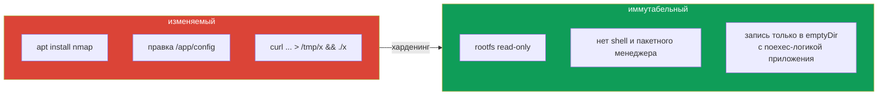

# Глава 24. Иммутабельность контейнеров в рантайме

> **Что дальше.** Последняя техническая глава. Идея простая: контейнер после старта не должен
> меняться. Если в нём нельзя ничего записать, скачать и запустить, большая часть техник
> атакующего (загрузка инструментов, правка бинарников, persistence в контейнере) просто не
> работает, а любое отклонение становится ярким сигналом для детекта.

## 24.1. Что значит «иммутабельный контейнер»



Принципы:

- **изменения - только через новый образ** и новый деплой, никогда `kubectl exec` + правка;
- **rootfs только для чтения**, запись - в явно выделенные тома;
- **в образе нет инструментов** (shell, curl, пакетный менеджер) - глава 17;
- **процесс не может повысить права** (`allowPrivilegeEscalation: false`, drop ALL);
- **конфигурация и секреты** монтируются read-only.

## 24.2. readOnlyRootFilesystem

```yaml
apiVersion: apps/v1
kind: Deployment
metadata:
  name: immutable
  namespace: prod
spec:
  replicas: 1
  selector:
    matchLabels:
      app: immutable
  template:
    metadata:
      labels:
        app: immutable
    spec:
      securityContext:
        runAsNonRoot: true
        runAsUser: 101
        seccompProfile:
          type: RuntimeDefault
      containers:
      - name: nginx
        image: nginxinc/nginx-unprivileged:1.27-alpine
        securityContext:
          readOnlyRootFilesystem: true
          allowPrivilegeEscalation: false
          capabilities:
            drop: ["ALL"]
        volumeMounts:
        - name: tmp
          mountPath: /tmp
        - name: cache
          mountPath: /var/cache/nginx
        - name: config
          mountPath: /etc/nginx/conf.d
          readOnly: true
      volumes:
      - name: tmp
        emptyDir: {}
      - name: cache
        emptyDir:
          medium: Memory
          sizeLimit: 64Mi
      - name: config
        configMap:
          name: nginx-conf
```

Проверка:

```bash
kubectl -n prod exec deploy/immutable -- touch /test
# touch: /test: Read-only file system
kubectl -n prod exec deploy/immutable -- touch /tmp/test      # разрешено - emptyDir
```

Если приложение падает после включения `readOnlyRootFilesystem` - смотрите логи: оно
подскажет, куда пытается писать; этот путь выносим в `emptyDir`.

## 24.3. Найти изменяемые поды

Экзаменационная формулировка: «найдите поды в namespace, которые не являются
иммутабельными (могут писать в rootfs или привилегированы), и удалите/исправьте их».

```bash
kubectl -n prod get pods -o json | jq -r '
  .items[] | . as $p | .spec.containers[] |
  select((.securityContext.readOnlyRootFilesystem // false) == false
         or (.securityContext.privileged // false) == true) |
  "\($p.metadata.name)\t\(.name)"'
```

Обратите внимание: `privileged: true` делает контейнер фактически изменяемым, даже при
read-only rootfs (он может перемонтировать файловые системы).

## 24.4. Приёмы, если образ поменять нельзя

- **startupProbe/postStart, удаляющий shell** - «костыль», встречающийся в учебных задачах:
  ```yaml
  startupProbe:
    exec:
      command: ["rm", "/bin/sh", "/bin/bash"]
    initialDelaySeconds: 1
    periodSeconds: 5
  ```
  Работает только если rootfs доступна для записи и контейнер от root - то есть
  противоречит остальным мерам. Предпочтительнее собрать образ без shell.
- **PSS `restricted` + ValidatingAdmissionPolicy**, требующая `readOnlyRootFilesystem: true`
  для всех контейнеров namespace, - чтобы изменяемые поды не создавались вовсе.

```yaml
validations:
- expression: >-
    object.spec.containers.all(c, has(c.securityContext) &&
      has(c.securityContext.readOnlyRootFilesystem) &&
      c.securityContext.readOnlyRootFilesystem == true)
  message: "readOnlyRootFilesystem must be true"
```

## 24.5. Иммутабельность и детект

Иммутабельный контейнер предсказуем: он не должен ничего писать вне `emptyDir`, не должен
запускать новые бинарники, не должен открывать shell. Значит, правила Falco можно сделать
очень строгими - любое `spawned_process` с неожиданным именем или `open_write` вне
разрешённых путей в таком контейнере - почти гарантированно атака.

Отладка без shell - через ephemeral-контейнер, который не меняет исходный:

```bash
kubectl -n prod debug -it deploy/immutable --image=busybox:1.36 --target=nginx
```

## 24.6. Также иммутабельными делают

- **ConfigMap и Secret** - `immutable: true` (нельзя изменить, только пересоздать);
- **образы** - immutable-теги в реестре и ссылка по digest (глава 19);
- **ноды** - неизменяемые ОС (Bottlerocket, Flatcar, Talos), замена ноды вместо правки.

## 24.7. Итоги главы

- Иммутабельный контейнер: read-only rootfs, нет инструментов, нет эскалации, изменения только
  через новый образ.
- `readOnlyRootFilesystem: true` + `emptyDir` для путей записи.
- `privileged` ломает иммутабельность даже при read-only rootfs.
- Поиск изменяемых подов - jq по `securityContext`; предотвращение - PSS + VAP.
- Иммутабельность делает runtime-детект точным; отладка - `kubectl debug`.

## 24.8. Вопросы для самопроверки

1. Какие меры в совокупности делают контейнер иммутабельным?
2. Что делать, если приложение падает после включения `readOnlyRootFilesystem`?
3. Почему privileged-контейнер нельзя считать иммутабельным?
4. Как запретить создание подов без read-only rootfs в namespace?
5. Как отлаживать контейнер без shell?

## Практика

Харденинг Deployment (read-only rootfs, non-root, без эскалации) - задача **10 (Deployment
security)**:

🧪 Мок 01: [tasks/cks/mock/01](../../mock/01/README.MD)

Задача **6 (Deployment security)**:

🧪 Мок 04: [tasks/cks/mock/04](../../mock/04/README.MD)

---
[Оглавление](../README_RU.md) · [Глава 23](../23/ru.md) · [Глава 25](../25/ru.md)
