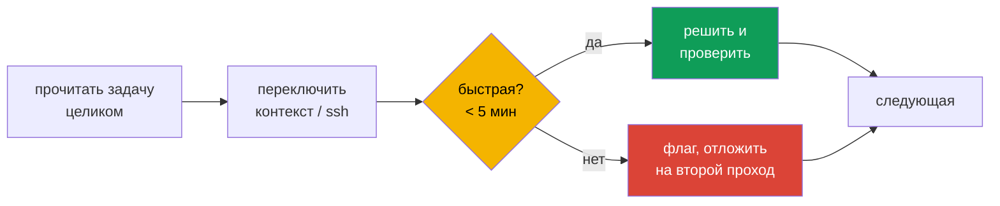

# Глава 25. Экзамен CKS: формат, стратегия и чек-лист

> **Финиш.** Теория пройдена, лабы решены. Осталось сдать. CKS - один из самых жёстких по
> времени экзаменов CNCF: задач много, многие требуют правки static pod манифестов и работы по
> ssh на разных нодах. В этой главе - формат экзамена, стратегия, частые ошибки и шпаргалка
> по доменам.

## 25.1. Формат

| Параметр | Значение |
|----------|----------|
| Формат | онлайн, с прокторингом, практические задачи в командной строке |
| Длительность | 2 часа |
| Версия Kubernetes | v1.35 (обновляется через 4-8 недель после релиза новой минорной) |
| Предварительное условие | сданный CKA |
| Попытки | две (одна пересдача) |
| Симулятор | killer.sh, 2 сессии по 36 часов, 17 задач в каждой |
| Срок действия | 2 года |

Проходной балл и количество задач уточняйте в актуальном Candidate Handbook и Exam Tips на
сайте Linux Foundation - они иногда меняются. Традиционно порог для CKS - 67%.

Во время экзамена разрешено пользоваться документацией Kubernetes и документацией
инструментов, указанных в Exam Tips (например, Falco, Trivy, etcd, AppArmor и др.). Список
проверяйте перед экзаменом.

## 25.2. Окружение

- Удалённый рабочий стол с терминалом и браузером; копирование - `Ctrl+Shift+C/V`.
- Каждая задача указывает, где её решать: контекст kubectl и/или хост для `ssh`. **Всегда**
  переключайтесь на указанный контекст/хост в начале задачи.
- Для задач на ноде: `ssh <host>`, затем `sudo -i`. Не забывайте выйти обратно (`exit`) перед
  следующей задачей.
- Настройте в начале:

```bash
alias k=kubectl
export do="--dry-run=client -o yaml"
export now="--force --grace-period 0"
source <(kubectl completion bash); complete -o default -F __start_kubectl k
cat >> ~/.vimrc <<V
set expandtab tabstop=2 shiftwidth=2
V
```

## 25.3. Стратегия



- **Два прохода**: сначала всё быстрое (NetworkPolicy, RBAC, PSS, SA, trivy, securityContext),
  потом тяжёлое (audit, ImagePolicyWebhook, encryption, upgrade, Falco).
- **Вес задачи** указан в условии - дорогие задачи не бросайте, дешёвые не «вылизывайте».
- **Задачи с apiserver - самые рискованные**: сломанный apiserver блокирует и эту, и
  последующие задачи на этом кластере. Бэкап манифеста, аккуратные правки, проверка, что API
  поднялся.
- **Проверяйте результат** каждой задачи: `kubectl get`, `auth can-i`, `curl`, `exec`.
- **Сохраняйте артефакты ровно по указанному пути** и в указанном формате.

## 25.4. Частые ошибки

| Ошибка | Как избежать |
|--------|--------------|
| забыли volume/volumeMount для файла в манифесте apiserver | для каждого нового пути - проверить, что он смонтирован |
| бэкап манифеста в `/etc/kubernetes/manifests/` | класть в `/root/` или `/tmp/` |
| решили задачу не в том контексте/на не той ноде | первая команда задачи - переключение |
| NetworkPolicy «ИЛИ» вместо «И» | проверять отступы, `kubectl describe netpol` |
| забыли DNS при default-deny egress | отдельная политика на 53 UDP/TCP |
| PSS: Deployment создан, а поды нет | смотреть события ReplicaSet |
| encryption включили, но не перезаписали secrets | `kubectl get secrets -o json \| kubectl replace -f -` |
| AppArmor-профиль не загружен на ноде пода | `apparmor_parser` на нужной ноде, nodeSelector |
| seccomp путь абсолютный вместо относительного | путь относительно `/var/lib/kubelet/seccomp/` |
| изменили SA, а поды старые | `kubectl rollout restart` |
| правка `falco_rules.yaml` | изменения - в `falco_rules.local.yaml` |
| kubelet не стартовал после правки | `journalctl -u kubelet -e` |

## 25.5. Шпаргалка по доменам

**Cluster Setup (15%)**
- NetworkPolicy: default deny + DNS + точечные allow; `kubernetes.io/metadata.name`.
- kube-bench: `run --targets master|node`, remediation.
- Ingress TLS: `kubectl create secret tls`, `spec.tls`, проверка `curl --resolve`.
- Metadata: egress except `169.254.169.254/32`; kubelet anonymous off / Webhook / readOnlyPort 0.
- Бинарники: `sha512sum`, `sha256sum --check`.

**Cluster Hardening (15%)**
- RBAC: `kubectl create role/rolebinding`, `auth can-i --list --as=`.
- CSR: `openssl req -subj "/CN=user/O=group"`, `certificate approve`.
- SA: `automountServiceAccountToken: false`, `kubectl create token`.
- API: `--anonymous-auth`, `Node,RBAC`, `NodeRestriction`, сервис `kubernetes` ClusterIP.
- Upgrade: репозиторий → kubeadm → `upgrade apply/node` → drain → kubelet → uncordon.

**System Hardening (10%)**
- `ss -tulpn`, `systemctl disable --now`, `apt purge`, `/etc/modprobe.d/`.
- AppArmor: `apparmor_parser`, `aa-status`, `appArmorProfile.type: Localhost`.
- seccomp: `/var/lib/kubelet/seccomp/`, `seccompProfile.type: Localhost|RuntimeDefault`.

**Microservice Vulnerabilities (20%)**
- PSA: `pod-security.kubernetes.io/enforce=baseline|restricted`.
- securityContext: runAsNonRoot, allowPrivilegeEscalation false, drop ALL, readOnlyRootFilesystem.
- Secrets: etcdctl с `apiserver-etcd-client`, `EncryptionConfiguration`, replace.
- gVisor: containerd runtime `runsc`, `RuntimeClass handler: runsc`, `runtimeClassName`.
- Шифрование: Cilium `encryption.type=wireguard`, Istio `PeerAuthentication STRICT`.

**Supply Chain (20%)**
- Dockerfile: версия базы, `USER` non-root, минимум пакетов, multi-stage.
- SBOM: `trivy image --format spdx-json|cyclonedx`, `bom generate`, `trivy sbom`.
- Admission: ImagePolicyWebhook (`defaultAllow: false`), VAP + binding, Gatekeeper.
- cosign: `sign`/`verify`; образы по digest.
- Анализ: `kubesec scan`, `kube-linter lint`, `trivy image --severity`.

**Monitoring, Logging, Runtime (20%)**
- Audit: policy (первое совпадение), `--audit-policy-file`, `--audit-log-path`, volumes.
- Falco: `falco_rules.local.yaml`, `override`, поля `%container.id %k8s.pod.name`.
- Расследование: `crictl ps/inspect`, `/proc/<pid>/exe`, `ss -tpn`, scale 0.
- Иммутабельность: `readOnlyRootFilesystem` + `emptyDir`, без privileged.

## 25.6. План подготовки

1. Пройдите главы по порядку и после каждой - соответствующую лабу из `tasks/cks/labs`.
2. Повторите лабы, на которых ошибались, **на время** (5-8 минут на задачу).
3. Решите мок-экзамены `tasks/cks/mock/01..04` в режиме экзамена: 2 часа, только
   документация, без подсказок. Цель - 75%+ с запасом.
4. Пройдите обе сессии killer.sh (они сложнее реального экзамена - это нормально).
5. Накануне - повторите раздел 25.4 и шпаргалку 25.5.

## 25.7. Вопросы для самопроверки

1. Какой порядок решения задач вы выберете и почему?
2. Что вы сделаете первым делом в каждой задаче?
3. Как минимизировать риск «положить» apiserver и что делать, если это случилось?
4. Какие три ошибки из раздела 25.4 вы допускали в лабах чаще всего?

## Практика

Мок-экзамены в формате CKS:

🧪 Мок 01: [tasks/cks/mock/01](../../mock/01/README.MD)
🧪 Мок 02: [tasks/cks/mock/02](../../mock/02/README.MD)
🧪 Мок 03: [tasks/cks/mock/03](../../mock/03/README.MD)
🧪 Мок 04: [tasks/cks/mock/04](../../mock/04/README.MD)

```bash
TASK=01 make run_cks_mock      # развернуть мок-экзамен
TASK=01 make delete_cks_mock   # удалить
```

Удачи на экзамене!

---
[Оглавление](../README_RU.md) · [Глава 24](../24/ru.md)
